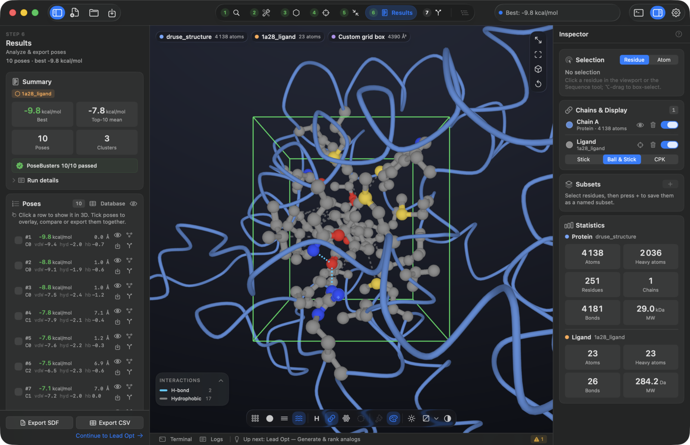

# Analysis

What Druse does with a docking run once the search stops: pose clustering, per-term energy breakdown, interaction detection, physical validity checks, RMSD, multi-pose comparison and export.

Contents: [Output selection and clustering](#output-selection-and-clustering) · [Score breakdown](#score-breakdown) · [Interactions](#interactions) · [2D interaction diagram](#2d-interaction-diagram) · [Pose validity](#pose-validity) · [RMSD](#rmsd) · [Multi-pose comparison](#multi-pose-comparison) · [Results Database](#results-database) · [Export](#export) · [Console commands](#console-commands)

See also [Docking.md](Docking.md) for the search itself, [Scoring.md](Scoring.md) for the scoring functions, [Visualization.md](Visualization.md) for the 3D view and [VirtualScreening.md](VirtualScreening.md) for batch runs.



## Output selection and clustering

A multi-run GA / Monte-Carlo search ends with thousands of final-population poses, most of them unconverged. Druse reduces them in the same order AutoDock Vina does, in `DockingEngine+Analysis.swift`:

1. **Energy window.** Only poses scoring within `outputEnergyRangeKcal` = 3.0 kcal/mol of the best pose are kept (`withinOutputEnergyWindow`). For an affinity scorer (DruseAFv4), whose `energy` is on a −pKd scale, the window is divided by `RT·ln 10` (0.0019872 × 298.15 × ln 10 kcal/mol per pKd unit) so the same 3 kcal/mol span applies.
2. **Greedy leader clustering.** Survivors are sorted by score; the best unassigned pose becomes a cluster leader and absorbs every unassigned pose within `clusterRMSD` = 2.0 Å heavy-atom RMSD. Clustering stops after `outputMaxClusters` = 20 modes; poses never absorbed are dropped.
3. **Duplicate removal.** Inside a cluster, a pose closer than `outputDuplicateRMSD` = 1.0 Å to a better pose already kept is discarded — many independent walkers converge on the same minimum.
4. **Explicit rerank of cluster representatives.** The top `explicitRerankTopClusters` = 12 basin representatives are rescored against explicit receptor atoms rather than grid interpolation, with `explicitRerankVariantsPerCluster` = 4 seeded refinements each and `explicitRerankLocalSearchSteps` = 20 local-search steps.
5. **Vina intra-energy re-referencing** (plain Vina scoring, rigid receptor only). The GPU kernels subtract the input conformer's intramolecular energy, which makes absolute scores depend on the input geometry. Each reported score is shifted onto the best pose's own intra energy, as Vina's `eval_adjusted` does. The shift is a per-run constant, so ranking, the energy window and clustering are unaffected.

Each surviving pose carries `clusterID` (the binding mode) and `clusterRank` (0 for the representative). The Results step reports "Kept N of M poses"; the activity log records the same numbers together with the thresholds used.

RMSD here is heavy-atom RMSD in the ligand's own atom order, with **no symmetry correction**, computed as `Σ|a_i − b_i|² < t²·N` with early exit. Clustering evaluates only leader-versus-candidate distances rather than materialising the full n(n−1)/2 matrix, runs off the main actor, and is parallelised across CPU workers once a leader has 2048 or more candidates.

## Score breakdown

`DockingResult` keeps the total and its components, and the five energy terms sum exactly to the total:

| Field | Console / CSV name | Meaning |
|---|---|---|
| `energy` | `Energy` | Total score — kcal/mol for Vina, Drusina and PIGNet2 |
| `stericEnergy` | `Steric` | gauss1 + gauss2 + repulsion (shown as "vdW") |
| `hydrophobicEnergy` | `Hydrophobic` | Hydrophobic term |
| `hbondEnergy` | `HBond` | Directional H-bond term |
| `torsionPenalty` | `Torsion` | Rotatable-bond (rotational entropy) penalty |
| `intraAndOtherEnergy` | `Intra_and_Other` | `energy` minus the four above: ligand internal energy relative to the reference conformer, out-of-box and constraint penalties, Drusina corrections |
| `drusinaCorrection` | `Drusina_Correction` | Drusina's π, halogen, metal and salt-bridge extensions |
| `constraintPenalty` | `Constraint_Penalty` | Pharmacophore constraint penalty (0 = all satisfied) |
| `strainEnergy` | `Strain_Energy` | MMFF94 ligand strain, docked minus relaxed |
| `refinementEnergy` | `Refinement_Energy` | OpenMM pocket interaction energy — annotation only, never part of the ranking |
| `gfn2Energy`, `gfn2DispersionEnergy`, `gfn2SolvationEnergy` | `GFN2_*` | GFN2-xTB total, D4 dispersion and implicit-solvation components |
| `formLabel`, `formPopulation` | `Form`, `Form_Population` | Ensemble multi-start metadata (tautomer/protomer label and Boltzmann fraction) |

For DruseAFv4 the stored "terms" are not energies: the pKd sits in `stericEnergy` and the model confidence (0–1) in `hydrophobicEnergy`, so `results` prints pKd and a confidence percentage instead of a term breakdown, and the ranking energy is −pKd × confidence.

`results show <n>` prints everything known about one pose: score and its terms, cluster and member index, strain, OpenMM and GFN2-xTB annotations, RMSD to the input pose, chemical form, validity, pose centroid, torsion count and the generation in which it was found.

## Interactions

Interaction detection is geometric and runs after the pose is chosen; it is independent of the scoring function, but the display is **gated** by it so no line appears for a contact the active score cannot see:

| Scoring function | Interaction types reported |
|---|---|
| Vina | H-bond, hydrophobic |
| Drusina | all ten types |
| Vina + PIGNet2 | H-bond, hydrophobic, metal coordination |
| DruseAFv4 | none — a learned scorer has no per-interaction terms, so lines are hidden |

`interactions ... all=on` and `export interactions ... types=all` bypass the gate and report every type the detector knows.

The ten declared types, their geometric criteria as implemented, and their colours:

| Type | Console name | Code | Criteria | Colour |
|---|---|---|---|---|
| H-bond | `hbond` | HB | 2.2–3.5 Å, N/O on both sides, at least one side carrying a hydrogen | cyan |
| Hydrophobic | `hydrophobic` | HY | 3.4–4.0 Å, C/S ↔ C/S, at most 2 per ligand atom | grey |
| Salt bridge | `salt-bridge` | SB | < 4.0 Å between an opposite formal charge and a charged residue atom (`NZ`, `NH1`, `NH2`, `NE` positive; `OD1`, `OD2`, `OE1`, `OE2` negative) | orange |
| π–π stack | `pi-stack` | PS | ring centroids 3.3–5.5 Å; face-to-face \|n·n\| > 0.85 and d < 4.2 Å, or edge-to-face \|n·n\| < 0.5 and 4.0–5.5 Å | purple |
| π–cation | `pi-cation` | PC | ring centroid to cation < 5.0 Å, with \|cos\| > 0.6 against the ring normal | magenta |
| Halogen bond | `halogen` | XB | 2.5–3.5 Å, ligand F/Cl/Br ↔ protein N/O | green |
| Metal coordination | `metal` | MC | < 2.8 Å, Fe/Zn/Ca/Mg/Mn/Cu ↔ N/O/S | gold |
| CH–π | `ch-pi` | CP | declared type, scored as a Drusina term; the geometric detector does not emit it | light purple |
| Amide–π | `amide-pi` | AP | declared type, scored as a Drusina term; not emitted by the detector | amber |
| Chalcogen bond | `chalcogen` | CB | declared type, scored as a Drusina term; not emitted by the detector | yellow-green |

Donor classification is explicit, not element-based: an atom can donate only if it actually carries a hydrogen. Ligand donor and acceptor flags come from the bond graph (bond-order sum plus formal charge give the implicit-H count); protein flags come from a residue + atom-name table, because protein `Atom`s do not always carry explicit bonds. Two pure acceptors — a neutral tertiary amine and a deprotonated carboxylate, say — therefore never produce an H-bond.

Aromatic rings are found two ways. Protein rings use residue templates (PHE/TYR `CG CD1 CD2 CE1 CE2 CZ`, TRP `CG CD1 CD2 NE1 CE2 CE3 CZ2 CZ3 CH2`, HIS `CG ND1 CD2 CE1 NE2`). Ligand rings come from 5- and 6-membered cycles of the bond graph over C/N/O/S, kept only when every ring atom lies within 0.5 Å of the mean plane and all but at most one are C or N.

Detection runs on the GPU (`Metal/InteractionCompute.metal`, kernel `detectInteractions`): one thread per ligand atom scans every protein atom inside 6 Å, buffers up to 24 hits locally, and the threadgroup then takes a single atomic allocation using a prefix sum, writing at most 2048 interactions per pose. π-stacking and π-cation always run on the CPU because they need ring geometry. If the Metal device, pipeline or command buffer is unavailable or faults, the whole detector falls back to an equivalent CPU path with a 6 Å spatial grid, instead of reporting no contacts.

In the 3D view, interactions are drawn as colour-coded lines between the two endpoints (ring centroids for the π types, in which case the surrounding ring atoms are also rendered so a line does not point at empty space). Toggle them with `view interactions on|off`. `contacts` gives the complementary, type-free answer: every residue with a heavy atom inside a distance cutoff (default 4 Å, maximum 15 Å), with its closest atom pair and the number of pairs.

## 2D interaction diagram

The Interaction Diagram window is a radial schematic: a flat skeletal depiction of the ligand in the centre, interacting residues arranged around it, and one styled connector per interaction (dashed for H-bonds, a double dashed pair for salt bridges, an arc for hydrophobic contacts). It is opened per pose from the Results step, from the Results Database toolbar, or from a pose row's diagram button.

The depiction comes from RDKit 2D coordinates of the ligand SMILES (the recorded SMILES when there is one, otherwise derived from the atom graph) and is matched back onto the docked heavy atoms, falling back to SMILES order when the graphs cannot be aligned. The window supports zoom (0.3×–5×) and pan, double-click to reset, hover tooltips listing each contact of a residue with its distance, a legend with per-type counts, ligand-atom pharmacophore halos and residue classes (polar, acidic, basic, hydrophobic), and PNG (2× scale) or PDF export always rendered on white paper regardless of the app appearance. When RDKit cannot produce a 2D layout at all, the window shows the contacts as a residue table sorted by closest distance instead.

## Pose validity

`PoseValidator` implements a PoseBusters-style subset of physical checks that the available topology supports. It runs on every reported pose after docking, and on demand through the `validity` command:

| Check | Criterion |
|---|---|
| Bond lengths | every bond within 0.75–1.25 × the sum of the two covalent radii |
| Bond angles | every angle 70°–175°, raised to 180° at a two-coordinate sp centre (incident triple bond, or two cumulated double bonds) |
| Internal clash | heavy-atom pairs more than 3 bonds apart no closer than 0.7 × (vdW_i + vdW_j) |
| Protein clash | smallest ligand–protein heavy-atom distance ≥ 2.0 Å (severe clashes only; mild ones already show up in the score) |
| Connectivity | all heavy atoms reachable through bonds |
| Extent | ligand bounding box ≤ 30 Å on every axis |

Alongside the pass/fail flags, each report carries the worst bond-length ratio, the smallest internal non-bonded distance and the smallest ligand–protein distance. Protein atoms are pre-filtered to the ligand bounding box plus 5 Å. The Results step shows "PoseBusters N/M passed" with the first failing checks; the pose table's `Valid` column and the `Validity_Failures` export field carry the detail.

## RMSD

Three different RMSD questions, all heavy-atom and all without symmetry correction:

- **Against the input ligand** (`rmsd reference`) — the redocking RMSD when the input was a co-crystallised ligand. The reference is used only when the input ligand is actually placed in the search box: if its centroid lies more than 2 Å outside the selected pocket's box, the reference is treated as absent, because SMILES-built and freshly prepared conformers sit at the origin and would report a meaningless 40 Å. The table flags poses at or below 2 Å.
- **Between two poses** (`rmsd 1 2`) and **the pairwise matrix** (`rmsd matrix`) — the full n × n matrix, computed only when every selected pose has coordinates and the same atom count (a mismatch means different ligands and is reported as such).
- **To pose #1** — the Results step's pose rows show each pose's RMSD to the top-ranked pose; `results` adds an RMSD column against the input pose, and `results sort=rmsd` orders by it.

## Multi-pose comparison

Tick two or more poses in the Results step to get the selection bar: **View** shows them together in the viewport (best pose as the primary ligand, the others as ghosts), the Export menu writes just the selection as SDF, PDB or CSV, and **Multi-Pose Analysis…** opens a sheet with two tabs.

**RMSD** shows the pairwise matrix as a heatmap with three bands — ≤ 2 Å (same mode), 2–4 Å (similar), > 4 Å (distinct) — plus min, max and mean RMSD and the number of convergent pairs. Below it, *binding modes* are the connected components of the ≤ 2 Å graph (single linkage): one component means every selected pose is the same binding mode.

**Interactions** shows a residue × pose fingerprint heatmap. Each cell is coloured by interaction type, split into up to three vertical stripes when a residue makes several types with that pose, and the footer counts how many of the selected poses contact each residue. The summary counts *consensus* residues (contacted by every pose) and *majority* residues (more than half, but not all). The same data is available in the console as `fingerprint`, which prints the residue × pose table with two-letter type codes and a contact frequency per residue.

## Results Database

A separate window (⇧⌘R, or the Database button in the Results step) for browsing a whole run or a whole batch:

- **Sidebar** — the current run, or one row per batch ligand; selecting a ligand loads its poses as the current results.
- **Pose table** — sortable by rank, score, vdW, hydrophobic, H-bond, torsion, cluster or generation, with a filter field (`#3`, `C2` for poses; ligand names for a batch) and per-row buttons to show the pose in 3D or open its diagram.
- **Inspector** — the selected pose's energy breakdown, interaction summary and a miniature interaction diagram; with poses ticked but no row selected, it lists the ticked poses instead.
- **Correlation…** (batch runs only) — Spearman ρ, Pearson r, Kendall τ and R² between each ligand's best docking score and its measured affinity, a score-versus-pKi scatter, a rank comparison table, and a binding-site consensus section that identifies the most populated cluster across all docked ligands. Affinity values come from Ki/pKi/IC50 columns imported in the Ligand Database (see [Ligands.md](Ligands.md)).
- **Export** — poses as SDF, the table as CSV.

## Export

| What | File | Contents |
|---|---|---|
| Ranked poses | `.sdf` | One record per pose with every `DockingPoseRecord` field: rank, scoring function, score and unit, the five energy terms, Drusina correction, constraint penalty, cluster and cluster rank, generation, validity and failures, minimum protein distance, strain, OpenMM, GFN2 energies, chemical form and population |
| Ranked poses | `.pdb` | Multi-model PDB, one `MODEL` per pose with a score remark; `protein=on` instead writes the protein once and the poses as residues of chain X |
| Results table | `.csv` | The same fields as columns, prefixed by the ligand name |
| One pose | `.sdf` / `.pdb` | The ligand alone at its docked coordinates |
| One complex | `.pdb` | Protein plus one docked pose in a single file |
| Interactions | `.csv` | Type, distance, ligand atom index/element/name, chain, residue name and number, protein atom and element, and both endpoint coordinates |
| Prepared protein | `.pdb` | Optionally without hydrogens, optionally with the active ligand appended as HETATM |

`top=N` and `cluster-representatives=on` select which poses are written and apply to both the SDF and the CSV; exported poses keep their rank from `results`. The pose SDF defaults to the 50 best poses. In the GUI, the Results footer has Export SDF and Export CSV buttons, and each pose row can save its complex as PDB.

## Console commands

Ranked poses, clusters and one pose in detail:

```
results
results top=25
results sort=cluster
results sort=rmsd top=5
results cluster=0
results clusters
results show 1
pose show 3
```

Interactions and contacts of a pose, of the crystal ligand, or restricted to one type:

```
interactions
interactions pose=3 type=hbond
interactions ligand=on all=on
contacts pose=2 cutoff=4.5
fingerprint top=10
```

RMSD and validity:

```
rmsd 1 2
rmsd matrix top=5
rmsd reference top=10
validity top=20
validity ligand=on
```

Export:

```
export poses out/poses.sdf top=10
export poses out/representatives.pdb cluster-representatives=on
export results out/results.csv
export pose 3 out/pose3.sdf
export complex 1 out/best_complex.pdb
export interactions out/contacts.csv pose=1 types=all
```

A full post-run script:

```
dock preset=thorough scoring=drusina
results top=10
results clusters
validity top=10
interactions pose=1
rmsd reference top=5
export poses out/poses.sdf top=10
export results out/results.csv
export complex 1 out/complex.pdb
```

See [Console.md](Console.md) for the terminal and headless mode, and [DruseScript.md](DruseScript.md) for the language and the full command reference.
