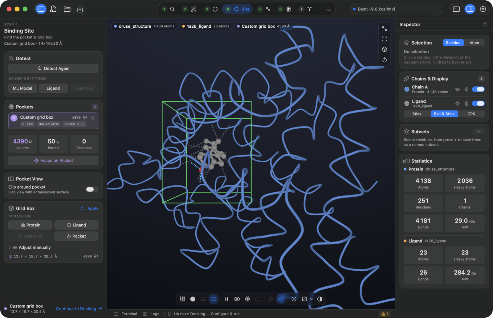

# Binding Site

How Druse finds and defines the pocket to dock into: geometric alpha-sphere detection, the CoreML pocket predictor, ligand- and selection-based definition, the grid box, pocket metrics and the slab view.

## Four ways to define the site

| Method | Command | When to use it |
| --- | --- | --- |
| Hybrid (ML + geometric) | `pocket detect` | nothing known about the site |
| Geometric only | `pocket detect method=geometric` | no ML model bundled, or a reproducible purely geometric run |
| ML only | `pocket detect method=ml` | compare the predictor against the geometric detector |
| From the ligand | `pocket detect method=ligand` | a co-crystallised or already-placed ligand marks the site |
| From residues | `pocket residues …` / `selection pocket` | the site is known from the literature or mutagenesis |
| Explicit box | `pocket box center=… size=…` | reproducing someone else's docking box |

## Geometric detection

Alpha-sphere probing followed by DBSCAN clustering and buriedness scoring. Hydrogens and crystallographic waters are excluded from the protein snapshot — waters are displaced by the ligand and must not fill, and so hide, the cavity. Whole chains can be excluded too.

1. **Probe grid.** The heavy-atom bounding box is padded by 6 Å and filled at 1.5 Å spacing.
2. **Surface filter.** A probe is kept when its distance to the nearest atom's van der Waals surface is between 1.2 Å and 5.5 Å. The lower bound is roughly where a ligand heavy atom's centre sits in contact; a larger value carves away narrow clefts and leaves only fragments of the real site.
3. **Buriedness.** 26 rays are cast from each probe — the 6 face normals, 12 edge midpoints and 8 cube vertices of the unit cube, normalised — out to 10 Å. Buriedness is the fraction of rays that hit a van der Waals sphere. Probes below 0.45 are dropped.
4. **Clustering.** DBSCAN over the surviving probes with ε = 3.0 Å and minPts = 5, using a uniform grid for neighbourhood queries.
5. **Pocket construction.** Volume is the probe count times the cell volume (spacing³); clusters under 100 ų are discarded as micro-pockets. Protein atoms within 4.5 Å of any cluster probe form the pocket lining, from which polarity (fraction of N/O) and hydrophobicity (fraction of C/S) are computed, and the distinct standard residues become the pocket's resident residues.
6. **Ranking.** `druggability = ln(volume) × buriedness × (1 + hpBalance) × sizeScore`, where `hpBalance = 1 − 2·|hydrophobicity − 0.65|` peaks at 65 % hydrophobic lining and `sizeScore` is 1.0 for volumes between 300 ų and 2000 ų, 0.5 otherwise. This is an fpocket-inspired multi-factor rank score, not a probability.
7. **Search box.** Half-extents of the cluster plus 4 Å padding, with a floor of 7.5 Å per axis (15 Å across) so even shallow pockets produce a box large enough to dock into.

Steps 2–3 run as Metal compute kernels (`computePocketDistanceGrid`, `scorePocketBuriedness`) with a CPU path when no GPU pipeline is available.

## The CoreML pocket predictor

An optional 3D U-Net (`PocketDetector.mlmodelc`) that labels pocket voxels directly. The protein's heavy atoms are voxelised into a 10-channel 64³ grid at 1 Å per voxel, centred on the atom centroid. The channels encode occupancy together with per-residue Kyte–Doolittle hydrophobicity (normalised by 4.5, as in training), partial charges at pH 7.4 on the charged side-chain atoms (Asp OD1/OD2 and Glu OE1/OE2 −0.5, Lys NZ +1.0, Arg NE/NH1/NH2 +0.33, His ND1/NE2 +0.25), aromatic ring atoms (Phe, Tyr, Trp, His), and H-bond donors and acceptors.

Voxels whose predicted probability exceeds the model's own threshold (read from the model metadata, 0.01 by default) are converted back to coordinates and clustered into pockets. Their cavity volume and buriedness are then measured with exactly the same geometry as the grid detector — only points outside every heavy atom's van der Waals sphere count, and buriedness uses the same 26-ray estimate — so ML and geometric pockets are directly comparable.

When the model is not bundled, `pocket detect` logs that geometric detection is being used and carries on.

## The hybrid ranking (`method=auto`)

`auto` runs both detectors, takes the top three pockets from each and ranks them with one shared heuristic:

```
score = ln(volume) × max(buriedness, 0.05) × (1 + max(polarity, 0.25))
      + 0.04 × min(residueCount, 30)
      − 4.0  if buriedness < 0.12
      − 2.0  if volume < 150 ų
      − 1.5  if the smallest half-extent < 5 Å
      − 0.5  if the largest half-extent > 18 Å
      + 0.3  for a geometric pocket
```

A pocket is flagged **suspicious** when its buriedness is below 0.12, its volume below 150 ų (the smallest cavity treated as able to hold a drug-like ligand; real sites measure roughly 200–1500 ų), its smallest half-extent below 5 Å, or it has no resident residues. Non-suspicious candidates sort ahead of suspicious ones, then by score, then by druggability. Candidates whose centres are within 4 Å of an already-accepted one are dropped as duplicates, and the survivors are renumbered. The best candidate is selected and the grid box is placed on it; the activity log names whether it came from the ML or the geometric detector.

## From a ligand

`pocket detect method=ligand` builds the pocket around the ligand as it currently stands — the co-crystallised ligand of a fetched complex, or a ligand you have placed. Protein atoms within 6 Å of any ligand atom define the lining and its standard residues. The centre is the ligand centroid; the box is the half-extents of the lining plus the ligand, clamped at 25 Å per axis, plus 4 Å padding. Buriedness is measured at the centroid, polarity over the lining, and volume is the box volume.

This is the method to use for redocking validation, since the box then tightly wraps the known site.

## From residues or a selection

`pocket residues` takes residues as `[chain:][name]number` and builds the box from their atoms plus `padding=` (4 Å by default). The pocket centre is the centroid of those atoms, polarity is computed over them and buriedness at the centre.

In the UI the same path is *Define it from ▸ Selection*; in the console, build a selection first and convert it:

```druse
pocket residues A:ASP189 SER195 HIS57 padding=5
select within 6 of ligand; selection pocket
select residue A:25-30; selection pocket
```

## Pocket metrics

`pocket list` prints one row per pocket (`*` marks the selected one):

| Column | Meaning |
| --- | --- |
| `#` | 1-based index, used by `pocket select` |
| `Vol ų` | cavity volume |
| `Buried` | mean buriedness, 0–1 |
| `Drug.` | the detector's ranking score |
| `Res` | number of resident standard residues |
| `Center` | box centre in Å |
| `Box Å` | box half-extents |

Druggability is each detector's unbounded ranking score, not a 0–1 probability — compare it between pockets of one detection run, not across runs or against another program. The Binding Site step shows the same numbers: a row per pocket with volume, residue count, buriedness percentage and score, and a three-metric summary (Volume, Buried, Residues) for the selected one.

```druse
pocket list
pocket select 2
select pocket                           # select the residues lining the pocket
```

## The docking grid box

The box is what the docking search actually uses; the engine adds its own ligand-sized margin and adaptive grid sizing on top. It follows the selected pocket but can be set or fitted explicitly.

```druse
pocket box center=12.5,-3,40.2 size=22,22,22    # size = full edge lengths
pocket box grid-spacing=0.5
pocket box fit around=ligand padding=6
pocket box fit around=pocket padding=4
pocket box show
```

`pocket box show` prints the centre, the half-extents, the box volume, the affinity-grid spacing, the resulting search-grid point count and where the box came from (a numbered pocket with its residue count, an explicit box, or the grid sliders). Grid spacing is clamped to 0.2–1 Å and coarsened automatically when the grid would exceed GPU memory.

In the Binding Site step the **Grid Box** card centres the box on the protein centroid, the ligand, the selection or back on the detected pocket, with centre and half-size sliders and an *Apply* button.

## The pocket clip / slab view



*Focus on Pocket* points the camera at the pocket and prepares the slab values without switching clipping on. **Clip around pocket** then clips the view to a Z-slab through the pocket and draws a translucent surface, so the cavity and its lining are visible from outside.

Three thickness presets are expressed as multiples of the pocket's largest half-extent: **Tight** 1.5×, **Medium** 2.5×, **Wide** 4.0×. Thickness and offset can be fine-tuned from the clipping control in the viewport, or from the console:

```druse
view clip on thickness=12
view clip thickness=20 offset=-4
view clip off
view fit pocket
```

Slab thickness accepts 2–40 Å and the offset −20 to 20 Å. See [Visualization.md](Visualization.md) for the rest of the view commands.

## Console reference

```druse
pocket detect [method=auto|geometric|ml|ligand]
pocket list
pocket select <n>
pocket residues <residues…> [padding=]
pocket box [center=x,y,z] [size=x,y,z] [grid-spacing=]
pocket box show
pocket box fit [around=ligand|pocket] [padding=] [grid-spacing=]
```

Run `help pocket` for the full option list with current defaults.

## See also

- [Preparation.md](Preparation.md) — prepare the receptor first; `prep waters=pocket` needs a selected pocket
- [Ligands.md](Ligands.md) — the co-crystallised ligand that `method=ligand` uses
- [Docking.md](Docking.md) — how the box and pocket feed the search
- [Scoring.md](Scoring.md) — the grid maps built inside the box
- [Visualization.md](Visualization.md) — clipping, surfaces and the grid wireframe
- [Console.md](Console.md) and [DruseScript.md](DruseScript.md) — scripting site definition
