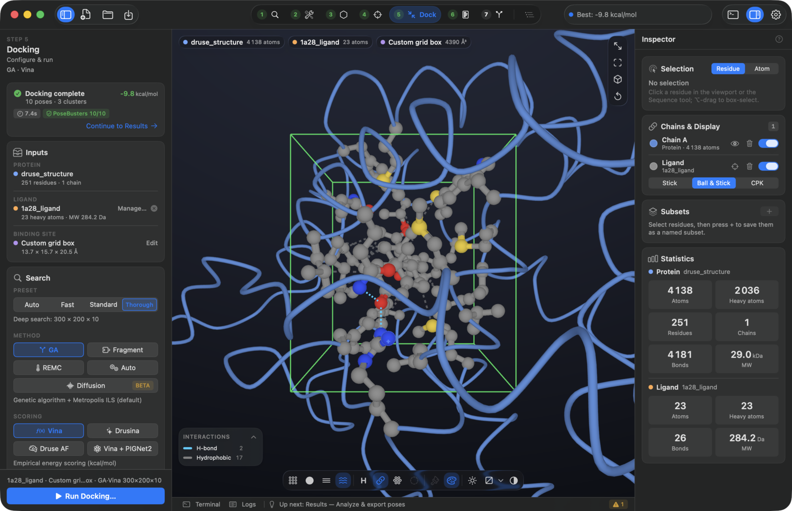

# Docking

Druse runs its whole pose search on the GPU: four search engines (Metropolis iterated local search, replica-exchange Monte Carlo, fragment growth, diffusion), precomputed Vina affinity maps, analytical-gradient local refinement, optional receptor side-chain flexibility, and pharmacophore constraints — all driven from the Docking step or the `dock` command.

Contents: [Prerequisites](#prerequisites) · [Worked example](#worked-example) · [Search presets](#search-presets) · [Search methods](#search-methods) · [GA / Metropolis ILS](#ga--metropolis-iterated-local-search) · [Local search](#local-search) · [Replica exchange](#replica-exchange-monte-carlo) · [Fragment docking](#fragment-based-docking) · [Flexible side chains](#flexible-side-chain-docking) · [Diffusion](#diffusion-guided-docking-beta) · [Grid maps](#grid-map-generation) · [Pharmacophore constraints](#pharmacophore-constraints) · [Auto-tuning](#auto-tuning) · [Batch docking](#batch-docking) · [Output selection](#output-selection) · [Settings reference](#settings-reference)



## Prerequisites

A docking run needs three things, and refuses to start without them:

| Requirement | How to get it |
|---|---|
| A protein | `load <file.pdb>`, then [`prep`](Preparation.md) |
| A binding site | `pocket detect`, `pocket residues …` or `pocket box center=…` — see [BindingSite.md](BindingSite.md) |
| A ligand | `ligand smiles …`, `ligand use …` or `load <file.sdf>` — see [Ligands.md](Ligands.md) |

`dock batch` needs no active ligand; it takes its ligands from the Ligand Database instead.

## Worked example

Redocking a crystal ligand into its own site, with a required salt bridge, a thorough budget and Drusina scoring, then post-docking refinement and export:

```
# 1. Load and prepare the receptor
load ~/targets/1add_protein.pdb
prep waters=remove ph=7.4

# 2. Load the reference ligand and define the site around it
load ~/targets/1add_ligand.sdf
pocket box fit around=ligand padding=6
pocket box show

# 3. Require the interaction the series is built on
#    (replace the residue with one that lines your own site)
constraint add salt-bridge residue=A:ASP189 radius=4 weight=8
constraint list

# 4. Configure and run
dock set search=ga scoring=drusina torsion-preset=redocking
dock set ls-steps=40 analytical-gradients=on rerank-clusters=12
dock preset=thorough

# 5. Inspect
results top=10
results show 1
results clusters

# 6. Post-docking refinement
strain top=20 threshold=4
refine gfn2 top=5 solvation=alpb level=tight

# 7. Export
pose show 1
export poses ~/Desktop/1add_poses.sdf top=5
```

`dock` prints the method, scoring function and budget before starting, streams a progress line while the run proceeds, and ends with the best score, pose count, cluster count and wall time. `dock stop` cancels a run; `dock status` reports whether one is in progress.

## Search presets

`preset=` (shared by the Docking step's preset buttons and `dock preset=…` / `dock set preset=…`) writes a search budget as *population × generations × runs*, plus a matching torsion-sampling policy. Setting `population`, `generations` or `runs` by hand turns `auto-tune` off and leaves the preset as `custom`.

| Preset | Population | Generations per run | Runs | Torsion policy | Notes |
|---|---|---|---|---|---|
| `auto` | 200 | 150 | 3 | balanced | Also sets `auto-tune=on`; the real budget is recomputed from the system at launch (see [Auto-tuning](#auto-tuning)) |
| `fast` | 50 | 30 | 3 | balanced | Quick exploration |
| `standard` | 150 | 80 | 5 | balanced | Balanced default |
| `thorough` | 300 | 200 | 10 | exploratory | Deep search |

Without a preset, the built-in defaults are population 300, 300 generations per run, 3 runs.

`dock config` prints every setting by section and stars the ones that differ from the default; `dock config changed=on` prints only those; `dock config reset [section]` restores defaults.

```
dock preset=fast
dock preset=thorough scoring=drusina
dock set population=200 generations=150 runs=4
dock config budget
```

## Search methods

| `search=` | Name | What it does |
|---|---|---|
| `ga` | GA | Genetic algorithm + Metropolis iterated local search (default) |
| `remc` | Replica Exchange | Replica-exchange Monte Carlo over a temperature ladder |
| `fragment` | Fragment | Incremental fragment construction with beam search |
| `diffusion` | Diffusion | DruseAF attention-gradient reverse diffusion — **BETA**, flagged in the UI |
| `auto` | Auto | Chooses from the ligand's rotatable-bond count at launch |

`search=auto` resolves at launch from the number of torsions the engine actually optimizes: more than 10 → `fragment`, more than 6 → `remc`, otherwise `ga`. The choice is written to the activity log.

`search=diffusion` requires DruseAF scoring. The console and the Docking step both promote `scoring` to `druseaf` automatically and say so.

## GA / Metropolis iterated local search

The default engine runs `numRuns` independent restarts. Each restart seeds a fresh population, then iterates `generationsPerRun` Monte Carlo steps. The per-step GPU pipeline is: perturb → score → (periodically) gradient local search → Metropolis accept/reject, with a separate per-pose "best so far" buffer that only ever improves.

**Population seeding** (`initializePopulation` in `DockingGA.metal`). Each restart draws a new `runSeed`, so the trajectories are genuinely independent.

- Translation: the first 40 % of the population is drawn inside a focused cube of half-width `min(0.65 × smallest box edge, 14 Å)` around the search centre; the remaining 60 % is drawn across the full search box.
- Rotation: a uniform random quaternion (Shoemake's method).
- Torsions: three tiers governed by the torsion policy — a leading `torsion-exact` fraction of the population keeps the input conformer exactly (all torsion genes at 0), the next `torsion-local` fraction perturbs every gene uniformly within ±`torsion-width` radians, and the tail resamples every gene uniformly in [−π, π].

**Move set** (`mcPerturb` in `DockingMonteCarlo.metal`). One degree of freedom is chosen uniformly per step out of `2 + numTorsions` (translation, rotation, or one torsion):

- Translation: a vector uniform inside a sphere of radius `translation-step`, clamped to the search box.
- Rotation: a rotation vector uniform inside a sphere of radius `max(rotation-step, translation-step / ligandRadius)`, applied as a quaternion increment.
- Torsion: with probability `torsion-reset` the angle is resampled uniformly in [−π, π]; otherwise it is shifted by a uniform step of amplitude `torsion-step × torsion-scale` and wrapped into [−π, π].

**Acceptance** (`metropolisAccept`). A candidate replaces the current pose when its energy is lower or non-finite energies are being replaced; otherwise it is accepted with probability `exp((E_current − E_candidate) / mc-temperature)`. The default `mc-temperature` is 1.2 kcal/mol, which matches AutoDock Vina's Metropolis temperature.

**Two-phase schedule.** The first `explore-ratio` (default 0.55) of each run's generations uses the wide exploration operators — `explore-translation` (5 Å), `explore-rotation` (0.8 rad), `explore-mutation` (0.35), local search every `explore-ls-frequency` generations at half the configured step count (minimum 5). After the cutoff the engine anneals linearly towards the refinement values: translation and rotation steps decay 30 % of the way from exploration to refinement values, the mutation rate 50 % of the way, and the Metropolis temperature from its full value down to 30 % of it, so acceptance tightens as the run converges. Local search then runs every `ls-frequency` generations at the full `ls-steps`.

Torsion policies (`torsion-preset`) set the five `torsion-*` values together; editing any of them switches the preset to `manual`.

| `torsion-preset` | `torsion-exact` | `torsion-local` | `torsion-width` (rad) | `torsion-reset` | `torsion-scale` |
|---|---|---|---|---|---|
| `balanced` | 0.40 | 0.40 | 0.55 | 0.15 | 1.0 |
| `redocking` | 0.70 | 0.25 | 0.25 | 0.05 | 0.4 |
| `exploratory` | 0.20 | 0.30 | 1.00 | 0.25 | 1.2 |
| `manual` | — | — | — | — | — (keeps current values) |

`ligand-flex=off` docks the input conformer rigidly, with no torsion sampling at all.

```
dock set search=ga torsion-preset=redocking mc-temperature=1.0
dock set explore-ratio=0.4 explore-translation=6 explore-ls-frequency=2
dock set ligand-flex=off
```

## Local search

Local search refines translation (3 DOF), rotation (3 DOF via axis–angle) and every ligand torsion in one steepest-descent loop, against the interpolated Vina affinity maps plus the intramolecular term and any constraint penalty. `ls-steps` (default 20, range 0–500) sets the iteration count; `ls-frequency` (default 3) sets how often it runs after the exploration phase. The loop uses a step size of 0.08 and stops early when the gradient norm falls below 1e-6.

Three kernels implement it, in `DockingLocalSearch.metal`:

- `localSearch` — central finite differences (`h` = 0.03 Å for translation, 0.02 rad for rotation and torsions). Used when `analytical-gradients=off`.
- `localSearchAnalytical` — exact gradients from a single forward pass; about 28× fewer energy evaluations than finite differences for a typical drug-sized molecule.
- `localSearchAnalyticalSIMD` — the analytical gradient distributed across one 32-lane SIMD group per pose, with the verification score computed inline in the same floating-point reduction order as the gradient loop (so steps are not falsely rejected). This is the default path.

`analytical-gradients=on` is the default. DruseAF scoring runs no Vina local search, because the affinity maps that the gradients come from are not the scoring function in that mode.

## Replica-exchange Monte Carlo

`search=remc` runs `remc-replicas` populations at different Metropolis temperatures and lets them swap configurations, so high-temperature replicas can cross barriers and hand good basins down to the cold replicas.

- The ladder is geometric: replica *k* of *K* gets `T_k = remc-tmin × (remc-tmax / remc-tmin)^(k/(K−1))`. Defaults are 8 replicas from 0.6 to 4.0 kcal/mol; `remc-tmin` must be below `remc-tmax`.
- Each replica holds `max(populationSize / K, 4)` poses. The number of replicas is capped by the kernel's `MAX_REPLICAS`.
- The trajectory length is `remc-steps` (default 200) — not `generations`, and REMC runs a single pass rather than `runs` restarts.
- Perturbation step sizes scale with `sqrt(T_k / T_min)`. Above a scale of 1.5, torsion moves become full uniform resamples instead of local perturbations.
- Acceptance uses each replica's own temperature.
- Every `remc-swap` steps (default 5), adjacent replica pairs attempt a swap with probability `min(1, exp((β_i − β_j)(E_i − E_j)))` evaluated on each replica's best pose, where β = 1/T. Swaps use a checkerboard parity (even steps swap even pairs, odd steps odd pairs) so no pair races another, and a successful swap exchanges the two replicas' whole populations.
- The same two-phase exploration/annealing schedule as the GA path applies within the trajectory.

```
dock set search=remc remc-replicas=12 remc-tmin=0.5 remc-tmax=6 remc-swap=4 remc-steps=400
dock
```

## Fragment-based docking

`search=fragment` builds the ligand into the pocket one rigid fragment at a time (`FragmentDockingEngine.swift`, `FragmentDocking.metal`). It needs the ligand's SMILES, because the decomposition into rigid fragments at rotatable bonds is done by RDKit in the C++ core.

1. **Decomposition.** The ligand is split into rigid fragments and an anchor fragment is chosen. `fragment-scaffold` accepts a SMARTS pattern that growth must keep as the anchor; `auto` (the default) uses the largest rigid fragment. Fragments are renumbered in breadth-first growth order with the anchor first; fragments not reachable from the anchor (counter-ions, for instance) are appended and never grown.
2. **Anchor placement.** `fragment-anchors` placements (default 256, up to 8192) are sampled across the search box with random positions and uniform random orientations, scored against the Vina affinity maps, and pruned.
3. **Beam pruning.** `pruneFragmentBeam` sorts by energy and keeps the best `fragment-beam` placements (default 32; the kernel's hard cap is 256) that also lie within `fragment-prune` kcal/mol (default 10) of the best partial pose.
4. **Growth.** For each surviving parent, the next fragment is placed by sampling `fragment-torsions` angles (default 36) about the real connecting bond; the expanded set is scored and pruned again. This repeats until every reachable fragment is placed. Each pruned beam level is kept so a finished chain can be traced back to its anchor placement.
5. **Refinement.** Surviving chains become rigid-body poses with torsions at the input conformer (fragment connecting torsions are not expressed in the ligand's torsion-tree indexing), and are then refined by Vina local search with at least 20 steps and scored with the active scoring function.

```
dock set search=fragment fragment-beam=64 fragment-anchors=1024 fragment-torsions=24 fragment-prune=8
dock set fragment-scaffold="c1ccc2[nH]cnc2c1"
dock
```

## Flexible side-chain docking

Receptor flexibility (induced fit) lets the search rotate the chi angles of a few pocket-lining side chains at the same time as the ligand pose. At most **6** residues can be flexible (`FlexibleResidueConfig.maxFlexibleResidues`). ALA, GLY and PRO have no rotatable side chain and are refused.

Two modes:

- **Full flexibility** — `flex add <residues…>` marks residues explicitly. Chi step 0.6 rad (~34°), pairwise weight 1.0.
- **Soft flexibility** — `flex auto` (or `dock set flex-auto=on`) picks the pocket-lining residues with rotamers that are closest to the pocket centre, at launch, up to the same limit of 6. Chi step 0.25 rad (~14°), pairwise weight 0.5. Turning it on clears any manual residues, and `flex add` turns it off.

How it is scored (`FlexDocking.metal`):

- The affinity grid maps are built with the flexible side-chain atoms **at their reference (chi = 0) positions**, so the flex kernel only adds the pairwise Vina delta `E(ligand, rotated flex) − E(ligand, reference flex)`. At chi = 0 the delta is exactly zero.
- The delta uses the same XS atom typing and Vina functional form as the grid maps, and sits inside the same rotatable-bond normalization as every other intermolecular term.
- Chi angles are part of the pose chromosome: `evolveChiAngles` mutates them alongside the ligand torsions and `localSearchFlex` refines them with analytical chi gradients (torque projection, not finite differences).
- Only heavy side-chain atoms are uploaded; backbone pivot atoms (CA for chi1, for example) are uploaded for the rotation axis but excluded from scoring. The kernel's per-thread arrays cap a run at 64 flex atoms and 24 chi slots — residues that do not fit are kept rigid and a warning is logged.

With flexible side chains enabled, Vina scores are *not* re-referenced to the best pose's intramolecular energy (see [Scoring.md](Scoring.md)).

```
flex add A:TYR95 A:ASP189 SER195
flex list
dock
flex auto
flex clear
```

## Diffusion-guided docking (BETA)

`search=diffusion` generates poses by reverse diffusion from noise, steered by per-atom attention gradients from the DruseAF network (`DiffusionDockingEngine.swift`, `DiffusionDocking.metal`). It is marked **BETA** in the Docking step because the DruseAF model was trained for affinity prediction, not denoising: the gradients are heuristic and pose quality is currently poor. Use `ga` or `fragment` for production work.

- Requires DruseAF scoring and loaded DruseAF weights; `scoring` is promoted to `druseaf` automatically.
- `diffusion-steps` (default 50) denoising steps run from *T−1* down to 0.
- `diffusion-schedule` selects the variance schedule: `cosine` (default, with the usual 0.008 offset so β₀ is non-zero), `linear` (β from 1e-4 to 0.02) or `quadratic` (same endpoints, quadratic ramp). σ_t = sqrt(1 − ᾱ_t).
- Per step, the noise levels applied are σ_t for translation, 0.3 σ_t for rotation and π σ_t for torsions.
- `diffusion-guidance` (default 1.0) scales the attention gradient. Each step encodes the ligand positions, scores with gradient (v4 PGN or v3 cross-attention, depending on the bundled weights), and denoises: the net translation gradient is the mean of the per-atom pull directions and the net rotation gradient the corresponding torque about the pose centre.
- `diffusion-refine` (default 30) Vina analytical local-search steps clean up contacts after denoising.
- Poses that drifted more than 1.5 Å (summed per axis) outside the search box are rejected; the rest are clamped back in. The population is then rescored with DruseAF, because the denoising kernel zeroes pose energies at the end of every step.

```
dock set search=diffusion diffusion-steps=80 diffusion-schedule=cosine diffusion-guidance=1.5 diffusion-refine=50
dock
```

## Grid map generation

Before any search, the receptor is baked into half-precision grid maps on the GPU (`DockingGridMaps.metal`). Hydrogens are excluded; protein atoms carry a van der Waals radius, an electrostatic charge, a Vina XS type and charged-group flags.

**Box construction.** The *search* box is the selected pocket's half-extent, raised if necessary so the ligand fits (at least the ligand's own extent plus 2 Å per axis). The *grid* box is the search box plus the ligand extent plus a further 3 Å of padding on every side, so a pose centred at the box edge still samples valid grid values. `pocket box show` prints the centre, edges, volume, spacing and point count, and notes that the engine adds this ligand-sized margin.

**Spacing.** `grid-spacing` defaults to 0.375 Å (range 0.2–1.0). If the total number of grid values would exceed 48 million across all maps, the spacing is coarsened — first by the cube root of the overshoot, then in 1.2× increments until it fits. A VRAM estimate above 85 % of the device's recommended working-set size is also logged as a warning. The effective spacing is written to the activity log.

**Maps computed.**

| Kernel | Map | Definition |
|---|---|---|
| `computeVinaAffinityMaps` | One affinity map per ligand XS type actually present | Full Vina pairwise potential summed over protein atoms within 8 Å, clamped to ±100. This is what the search scores against. |
| `computeStericGrid` | Steric | `wGauss1·exp(−(d/0.5)²) + wGauss2·exp(−((d−3)/2)²) + wRepulsion·d²` for d < 0, with d = distance − (R_protein + R_probe), R_probe = 1.8 Å |
| `computeHydrophobicGrid` | Hydrophobic | Hydrophobic protein atoms only; 1.0 below d = 0.5, 0 above d = 1.5, linear between, weighted by `wHydrophobic` |
| `computeHBondGrid` | H-bond | Donor/acceptor protein atoms only; 1.0 below d = −0.7, 0 above d = 0, linear between, weighted by `wHBond` |
| `computeElectrostaticGrid` | Screened Coulomb potential | Φ(r) = Σ 332·q_p / (4r²) (distance-dependent dielectric ε = 4r), cut off at 12 Å, r clamped to 0.8 Å, clamped to ±50. Used by Drusina. |

The affinity-map tiling loads protein atoms into threadgroup memory in a structure-of-arrays layout to avoid bank conflicts.

## Pharmacophore constraints

Constraints express interactions a pose must or should make. They enter the score as a penalty inside the GPU scoring and local-search kernels, so they bias the search itself rather than filtering afterwards. The GUI equivalent is the Pharmacophore editor in the Docking step.

```
constraint add <type> [residue=… | position=x,y,z] [atom=…] [scope=atom|residue] [radius=…] [strength=soft|hard] [weight=…]
```

| `<type>` | Interaction | Ligand atom types that can satisfy it |
|---|---|---|
| `donor` | H-bond donor | N_D, N_DA, O_D, O_DA, MET_D |
| `acceptor` | H-bond acceptor | N_A, N_DA, O_A, O_DA |
| `salt-bridge` | Salt bridge | N_D, N_A, N_DA, O_D, O_A, O_DA |
| `pi-stack` | π-stacking | C_H, C_P |
| `halogen` | Halogen bond | F_H, Cl_H, Br_H, I_H |
| `metal` | Metal coordination | N_P … O_DA, S_P |
| `hydrophobic` | Hydrophobic | C_H, C_P, F_H, Cl_H, Br_H, I_H |

**Target.** `residue=[chain:][name]number` (e.g. `A:ASP189`, `TYR95`, `120`) or an explicit `position=x,y,z`. `scope=residue` (the default when no `atom=` is given) expands the constraint into one target point per chemically relevant atom of that residue — for example both carboxylate oxygens of an ASP acceptor, or the six ring carbons of a PHE for π-stacking, with a fallback to all heavy atoms of the residue. `atom=<name>` (which implies `scope=atom`) targets one named atom.

**Radius.** `radius=` is the distance within which the interaction counts, 1.5–10 Å, default 3.5 Å.

**Strength.**

- `strength=soft` (the default) adds a quadratic penalty `weight × violation²` to the score, where the violation is how far the nearest compatible ligand atom sits beyond the radius. `weight=` is in kcal/mol/Ų, range 0.1–100, default 5.
- `strength=hard` uses an internal weight of 1000 kcal/mol/Ų, which in practice rejects violating poses. `weight=` is ignored and the console warns if you pass it.

**Group logic.** All target points expanded from one `constraint add` share a group ID, and a group uses OR logic: it is satisfied if *any* of its targets has a compatible ligand atom within the radius, so only the smallest violation in the group is penalized. Penalties are summed across groups. At most 16 GPU constraints are used per run (`MAX_PHARMACOPHORE_CONSTRAINTS`).

A satisfied constraint set contributes 0. The resulting penalty is reported per pose as `constraintPenalty` and folded into the `Intra+` / `Other` column of `results` — see [Scoring.md](Scoring.md).

```
constraint add salt-bridge residue=ASP189 radius=4
constraint add acceptor residue=A:SER195 atom=OG strength=hard
constraint add hydrophobic position=12.1,4.5,-3.2 weight=10
constraint list
constraint disable 2
constraint remove 1
constraint clear
```

## Auto-tuning

`auto-tune=on` (set directly or via `preset=auto`) recomputes the search budget at launch from the protein size, pocket shape and ligand flexibility, and logs what it chose. Your scoring, charge and flexibility choices are preserved; only the search parameters are overridden.

Let `T = max(1, rotatable_bonds / 5)`, `S = max(1, heavy_atoms / 20)`, `B = max(0.6, 1.5 − pocket_buriedness)` and `V = clamp(pocket_volume / 800, 0.8, 2.0)`.

| Parameter | Rule |
|---|---|
| `population` | `clamp(200 × sqrt(T·S), 150, 600)` |
| `generations` | `clamp(200 × B · V · sqrt(S), 120, 500)` |
| `runs` | `clamp(T · B · P · sqrt(S), 2, 10)`, where `P` = 1.5 above 5000 protein atoms, 1.2 above 3000, else 1.0 |
| `grid-spacing` | 0.5 Å above 10 000 protein atoms, else 0.375 Å |
| Exploration | Above 10 rotatable bonds: `explore-ratio` 0.5, `explore-translation` 5 Å, `explore-mutation` 0.18, torsion policy `exploratory`. Otherwise torsion policy `balanced`. |
| Local search | At most 3 rotatable bonds: `ls-frequency` 1 and `ls-steps` 40 (cheap, high payoff for rigid ligands). Above 15: `ls-frequency` 3 and `ls-steps` 20. |
| `search` | Above 10 rotatable bonds → `fragment`; above 6 → `remc`; otherwise `ga` |

The ligand's rotatable-bond count comes from the torsion tree RDKit builds from its SMILES, and the pocket volume and buriedness from the selected pocket.

```
dock set auto-tune=on
dock
```

## Batch docking

`dock batch` docks Ligand Database entries one after another with the current settings and ranks them. It needs a protein and a pocket but no active ligand.

| `ligands=` | Selects |
|---|---|
| `all` (default) | Every entry that has 3D coordinates |
| `prepared` | Every prepared entry with coordinates |
| `name1,name2,…` | Those entries by name; a prepared molecule's name selects every dockable chemical form enumerated from it |

A molecule that has been enumerated into forms is docked as its forms, not as the raw import as well. The run prints a ranking table (rank, ligand, score, poses, clusters) for the top 20; `results batch top=50` reprints it later, and `dock stop` cancels.

For screening a file-based library rather than the Ligand Database — with RDKit 3D preparation, a batched rigid prescreen, a GA-docked shortlist and optional refinement — use `screen`; see [VirtualScreening.md](VirtualScreening.md).

```
dock batch ligands=prepared preset=fast
dock batch ligands=aspirin,ibuprofen scoring=drusina
results batch top=50
```

## Output selection

Every search path ends with the same Vina-style output selection, documented in full in [Analysis.md](Analysis.md): poses more than 3.0 kcal/mol above the best are discarded, the remainder are greedy leader-clustered at 2.0 Å heavy-atom RMSD, poses within 1.0 Å of a better pose in the same cluster are dropped as duplicates, and at most 20 binding modes are reported. The top `rerank-clusters` cluster representatives are then rescored against explicit receptor atoms, with `rerank-variants` jittered seeds each refined for `rerank-steps` local-search steps.

## Settings reference

`dock set key=value …` changes any of these for the session; `dock config <section>` prints one group. Every value is validated against the range shown.

**Method** — `search`, `scoring`, `charges`, `auto-tune`.

**Search budget** — `population` (8–4096), `generations` (1–10 000), `runs` (1–100), `live-update` (1–10 000, default 10; refresh the live pose every N generations — higher means fewer GPU syncs).

**Grid maps** — `grid-spacing` (0.2–1.0 Å, default 0.375).

**Search operators** — `mutation-rate` (default 0.10), `crossover-rate` (default 0.75), `translation-step` (0.05–20 Å, default 3.0), `rotation-step` (0.01–3.1416 rad, default 0.3), `torsion-step` (0.01–3.1416 rad, default 0.8), `mc-temperature` (0.05–10 kcal/mol, default 1.2).

**Local search** — `ls-frequency` (1–100, default 3), `ls-steps` (0–500, default 20), `analytical-gradients` (default on).

**Exploration phase** — `explore-ratio` (default 0.55), `explore-translation` (0.05–30 Å, default 5.0), `explore-rotation` (0.01–3.1416 rad, default 0.8), `explore-mutation` (default 0.35), `explore-ls-frequency` (1–100, default 3).

**Ligand torsions** — `ligand-flex` (default on), `torsion-preset`, `torsion-exact`, `torsion-local`, `torsion-width` (rad), `torsion-reset`, `torsion-scale` (0–3).

**Explicit rerank** — `rerank-clusters` (0–100, default 12; 0 = off), `rerank-variants` (1–32, default 4), `rerank-steps` (0–200, default 20).

**MMFF94 ligand strain** — `strain` (default on; not applied with `scoring=vina`), `strain-threshold` (0–100 kcal/mol, default 6), `strain-weight` (0–10, default 0.5). See [Scoring.md](Scoring.md).

**Fragment search** — `fragment-beam` (1–1024, default 32), `fragment-anchors` (1–8192, default 256), `fragment-prune` (0–100 kcal/mol, default 10), `fragment-torsions` (1–360, default 36), `fragment-scaffold` (SMARTS or `auto`).

**Replica exchange** — `remc-replicas` (2–64, default 8), `remc-tmin` (default 0.6 kcal/mol), `remc-tmax` (default 4.0 kcal/mol), `remc-swap` (1–1000, default 5), `remc-steps` (1–100 000, default 200).

**Diffusion** — `diffusion-steps` (1–1000, default 50), `diffusion-schedule` (`linear`/`cosine`/`quadratic`, default cosine), `diffusion-guidance` (0–10, default 1.0), `diffusion-refine` (0–1000, default 30).

**GFN2-xTB refinement** — `gfn2`, `gfn2-top`, `gfn2-solvation`, `gfn2-level`, `gfn2-steps`, `gfn2-blend`, `gfn2-update`, `gfn2-restraint`, `gfn2-max-rmsd`. See [Scoring.md](Scoring.md).

**Receptor flexibility** — `flex-auto`.

---

See also: [Scoring.md](Scoring.md) for the four scoring functions and the post-docking refinements · [BindingSite.md](BindingSite.md) for pocket detection and the docking box · [Analysis.md](Analysis.md) for pose ranking, clustering, RMSD and interaction analysis · [VirtualScreening.md](VirtualScreening.md) for library screening · [LeadOptimization.md](LeadOptimization.md) for analog series · [Console.md](Console.md) and [DruseScript.md](DruseScript.md) for the command language · [Settings.md](Settings.md) · [Benchmark.md](Benchmark.md)
