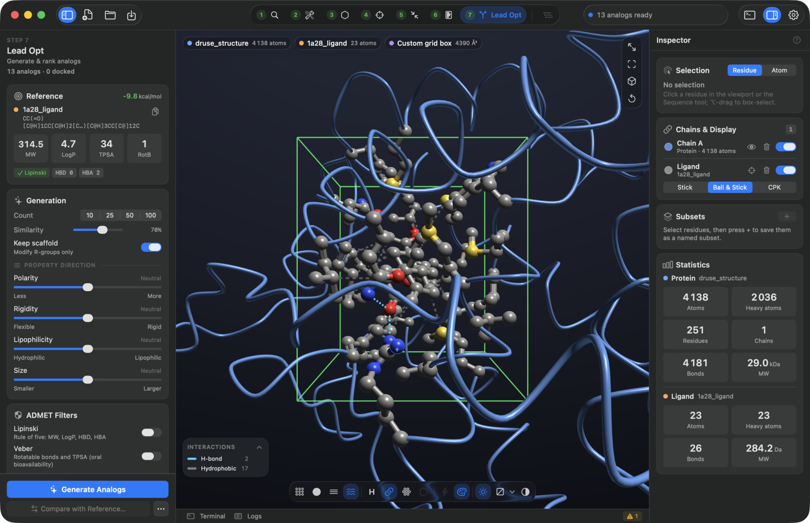

# Lead Optimization

Generating analogs of a docked pose with directed medicinal-chemistry edits, gating them on descriptors and predicted ADMET, mini-docking them in the same pocket and comparing them with the parent.

Contents: [Reference](#reference) · [The edit table](#the-edit-table) · [Keep scaffold](#keep-scaffold) · [Similarity and deduplication](#similarity-and-deduplication) · [Property direction](#property-direction) · [ADMET gating](#admet-gating) · [Ligand Database hand-off](#ligand-database-hand-off) · [Mini-docking](#mini-docking) · [Comparison](#comparison) · [Console commands](#console-commands)

Lead optimization is the last step of the pipeline; it starts from a pose produced by [Docking.md](Docking.md) or a hit from [VirtualScreening.md](VirtualScreening.md), and its analogs flow back into the [Ligand Database](Ligands.md).



## Reference

The reference is one molecule plus, optionally, one docked pose of it. Set it from a pose row's **Optimize** button in Results, from a screening hit's **Optimize** button, or with `leadopt reference`. Without a pose there is no reference score, so analog scores have nothing to compare against — generation still works, comparison does not.

Setting the reference also records the **scoring function** of the docking session. Analogs are later mini-docked with that same function, so their scores sit on the parent's scale (kcal/mol for Vina, Drusina and PIGNet2; pK for DruseAFv4).

The reference SMILES is resolved in three steps, because every edit is expressed on SMILES tokens and a reference that RDKit cannot read blocks the whole step:

1. the SMILES recorded with the ligand (SMILES input, Ligand Database entry, SDF property), when RDKit can parse it;
2. otherwise canonical SMILES from the heavy-atom graph, with implicit hydrogens — explicit H atoms are dropped, since `[H]` tokens break substituent edits;
3. otherwise the same graph with aromatic N–H hydrogens restored: first the explicit hydrogens the structure carries on aromatic nitrogens, then one synthetic H on each pyrrole-type nitrogen candidate in turn (five-membered rings first, which picks the usual tautomer). Crystal ligands often lack that hydrogen, and without it RDKit cannot kekulise the ring. A repair is reported in the activity log.

If none of the three produces a valid molecule the reference is refused with an explanation — load the ligand from SMILES, or from an SDF/MOL2 with explicit hydrogens and Kekulé bond orders.

## The edit table

Analogs come from a curated table of **23 medicinal-chemistry edits** in `AppViewModel+LeadOpt.swift`, in six families:

| Family | Count | Edits |
|---|---|---|
| Halogen swaps | 5 | F→Cl, Cl→F, F→Br, Cl→Br, Br→Cl, on terminal halogens |
| Aromatic C–H scans | 4 | H→F, H→Cl, H→Me, H→OH on an unsubstituted aromatic carbon |
| Methyl elaboration | 3 | Me→Et, Me→iPr, Me→CF3 on a terminal single-bonded methyl |
| Acyclic heteroatom swaps | 4 | O→NH, NH→O, O→S, S→O on non-ring heteroatoms |
| Acyclic functional-group swaps | 3 | CO₂H→CONH₂, CONH₂→CO₂H, C=O→SO₂ |
| Ring-atom edits | 4 | aza-walk CH→N and de-aza N→CH, cyclopentyl↔cyclohexyl |

Edits are applied to **atom tokens**, not raw substrings. A minimal SMILES tokenizer (`SMILESAtomGraph`) parses the reference into atom tokens with their text ranges, heavy-atom adjacency with bond symbols, and per-atom ring membership, so a methyl homologation can never land inside a ring (a raw `CC`→`CCC` once turned imatinib's piperazine into a homopiperazine) nor inside a bracket atom such as `[NH+]`. Group replacements are additionally anchored on whole atom tokens, rejected when the match would end inside an atom token or next to a ring-closure digit, and — unless the pattern itself contains a ring closure — rejected when any covered atom is in a ring.

Every matching site of every edit is enumerated, and the resulting pool is **interleaved round-robin across edits** (one site per edit per round) so a list truncated at `count` stays chemically diverse instead of filling up with ten positions of the first matching edit. Analogs are named `<reference>_<label>` with the site appended when an edit matched more than once, for example `imatinib_H→F@17`.

A second, independent generator exists for scaffold work: `Chemistry/ScaffoldAnalogGenerator.swift` enumerates a **71-group catalogue** (27 small substituents, 16 functional groups, 18 aromatics/heterocycles, 10 saturated rings and linkers) at the attachment points of a scaffold drawn in Ketcher, or applies **26 whole-molecule transforms** (halogen swaps, alkyl length, heteroatom swaps, functional-group swaps, aromatic swaps, ether/thioether swaps, ring expansion and contraction) when no attachment point is marked. That generator is driven from the Ligands step's scaffold sheet, with its own allow/deny lists, Lipinski filter and max-logP filter; it is not what `leadopt generate` uses.

## Keep scaffold

**Keep scaffold** (default **on**, `keep-scaffold=on|off`) restricts generation to R-group edits: the four `altersScaffold` edits — the two aza-walk edits and the two ring-size changes — are removed from the table, and any group replacement whose pattern contains a ring closure is skipped at every site. With it on, ring atoms are never touched, so every analog keeps the parent's ring system. Turning it off is the way to explore aza-scans and ring resizing; when no edit site matches at all with it on, the console says so and suggests turning it off.

## Similarity and deduplication

Each candidate passes three gates before becoming an analog:

1. **RDKit validation** — descriptors must compute, which rejects any edit that breaks valence or aromaticity.
2. **Duplicate rejection** — Morgan fingerprints are compared against the reference and every analog kept so far, because symmetry-equivalent sites yield different SMILES strings for the same molecule.
3. **Tanimoto floor** — `similarity` (default **0.70**; GUI slider 0.30–0.95 in steps of 0.05) is the minimum Tanimoto similarity to the reference. Candidates below it are counted and reported in the activity log.

Generation stops at `count` analogs: default **50**, GUI picker 10/25/50/100, console range 1–500.

## Property direction

Each edit carries a bias vector over four properties — polarity, rigidity, lipophilicity and size — with components in −1…+1. The four **direction sliders** (`polarity=`, `rigidity=`, `lipophilicity=`, `size=`, each −1…+1, default 0, snapped to steps of 0.1) express what you want:

| Slider | −1 | +1 |
|---|---|---|
| Polarity | Less polar | More polar |
| Rigidity | More flexible | More rigid |
| Lipophilicity | Hydrophilic | Lipophilic |
| Size | Smaller | Larger |

When the sliders are not all at centre (their absolute values sum to more than 0.01), the edit list is sorted by `alignment = Σ bias·direction` before site enumeration, so the best-aligned edits contribute their sites first and a list truncated at `count` is dominated by them. The sliders bias the *order* of chemistry that is tried; they do not filter analogs, and leaving all four at centre keeps the table's natural order. The GUI labels an off-centre slider as, for example, "+50% more polar".

## ADMET gating

Filters are applied after generation and mark an analog `filtered` rather than deleting it, so you can see what was rejected and why. All are **off by default**, deliberately: they are too restrictive for a first pass.

| Filter | Option | Criterion |
|---|---|---|
| Lipinski's rule of five | `lipinski=on` | MW ≤ 500, cLogP ≤ 5, HBD ≤ 5, HBA ≤ 10 |
| Veber | `veber=on` | rotatable bonds ≤ 10, TPSA ≤ 140 |
| Max logP | `max-logp=x` | cLogP above the value is rejected; default **7.0**, GUI slider 1–8 |
| hERG | `herg=on` | predicted hERG liability > 0.5 |
| CYP | `cyp=on` | predicted CYP2D6 or CYP3A4 inhibition > 0.5 |

The descriptor filters (Lipinski, Veber, max logP) always run — they come from RDKit descriptors. ADMET **prediction** only runs during generation when the hERG or CYP filter is on; otherwise it is computed lazily the first time an analog's detail view or `leadopt show` asks for it, and then kept on the analog. Without the CoreML ADMET models installed, the hERG and CYP filters cannot reject anything and the console warns about it.

Analogs end up in one of five states: `generated` (new), `prepared` (3D conformer built), `docked`, `filtered` (rejected by a filter) or `failed` (no valid conformer, or docking returned no pose). The Analogs card counts passed / filtered / failed.

## Ligand Database hand-off

At the end of a successful generation, every analog that passed the filters is **added to the Ligand Database automatically**, with its descriptors, skipping duplicates by SMILES. The status line reports both numbers ("32 analogs ready · 29 added to Ligand Database").

`leadopt send database` repeats the hand-off explicitly and can include the filtered analogs (`filtered=on`); `leadopt send docking` adds them and opens the Docking step so they can be run as a full `dock batch` — the route to take when the analogs deserve a full-budget docking run with a scoring function or search method other than the reference's.

## Mini-docking

`leadopt dock` (GUI: **Dock All Analogs**) scores the analogs still in `generated` state in the reference's own pocket, so the numbers compare 1:1 with the parent. It requires a docking engine and a selected pocket from a previous run on the reference — it reuses that receptor and pocket rather than re-preparing anything — and refuses while the engine is busy.

Budget: the session docking configuration with `populationSize` clamped to at most 150, `numRuns` forced to 1, `generationsPerRun` clamped to at most 150, and live viewport updates disabled. The engine's pose callbacks belong to the reference run (they draw poses with the reference's atoms and bonds), so they are detached for the duration and restored afterwards.

3D preparation per analog: RDKit generates 10 minimised conformers and the first one whose non-bonded heavy atoms are all at least 2.0 Å apart is used. The clash guard matters because MMFF can "converge" a charged molecule into a collapsed geometry that still ranks lowest in energy, and the docking engine takes its intramolecular reference from the input conformer — docking such a conformer would credit the released strain to binding. An analog with no clash-free conformer is marked `failed` and skipped.

Each docked analog keeps its best five poses, its best score in the reference's units, and the best pose's heavy-atom coordinates. When the run finishes, the list is re-sorted best score first (better meaning lower energy, or higher pK for an affinity model), with undocked analogs after them, and the selection follows the analog it was on. `leadopt stop` cancels generation or docking.

Selecting a docked analog shows its best pose as a ghost overlay in the viewport, with the reference as the primary ligand.

## Comparison

The Analogs list shows, per row, the status dot, the name, the property deltas versus the parent (`MW +16 · LogP −0.3`), the best score badge and the score delta (tinted as an improvement or a regression in the active scoring convention, neutral within ±0.05). The selected analog gets a 2D depiction, its SMILES, and a reference-versus-analog score pair.

**Compare with Reference…** opens the full comparison sheet:

- **Docking energy / affinity** — reference and analog side by side with a Δ tag in the method's units, tinted by whether the analog ranks better, worse, or indistinguishably (|Δ| ≤ 0.05).
- **Molecular properties** — a six-axis radar chart overlaying reference and analog on MW (scaled to 600), cLogP (6), TPSA (200), HBD (6), HBA (12) and rotatable bonds (15), beside a delta table of the same six descriptors. Property deltas are tinted by direction only, since a larger MW is neither good nor bad on its own.
- **ADMET profile** — Lipinski and Veber pass/fail, plus hERG risk, CYP2D6 and CYP3A4 inhibition, solubility (log S), BBB permeability and the drug-likeness composite, each flagged against its threshold (hERG < 0.5, CYP < 0.5, log S > −4, BBB > 0.5, drug-likeness > 0.5).

`leadopt show <n>` is the console equivalent: SMILES and reference SMILES, score with the reference's score and Δ, a descriptor table with deltas (MW, logP, TPSA, HBD/HBA, rotatable bonds, rings and aromatic rings, heavy atoms, fraction sp³, Lipinski/Veber), and the ADMET table when the models are loaded.

## Console commands

Pick a reference and inspect the settings:

```
leadopt reference pose=1
leadopt reference ligand=imatinib
leadopt config
```

Set generation parameters, property directions and filters (they persist for later runs):

```
leadopt set count=25 similarity=0.6 keep-scaffold=on
leadopt set polarity=0.5 lipophilicity=-0.3 size=0.2
leadopt set lipinski=on veber=on herg=on max-logp=5
leadopt defaults
```

Generate, review, dock:

```
leadopt generate count=30 keep-scaffold=off
leadopt list
leadopt list status=docked top=10
leadopt show 1
leadopt dock
leadopt stop
```

Hand off and export:

```
leadopt send database
leadopt send database filtered=on
leadopt send docking
export analogs out/analogs.csv
export analogs out/analogs.sdf status=docked
leadopt clear
```

`export analogs` writes name, SMILES, status, score and unit, the four property deltas, the full descriptor set with Lipinski and Veber verdicts, and the ADMET predictions (hERG, CYP2D6, CYP3A4, BBB, metabolic stability, log S, drug-likeness). `status=passed` writes everything not filtered or failed, `status=docked` only the docked analogs. The SDF carries the docked heavy-atom pose when the analog was docked, its prepared conformer otherwise, and a freshly embedded conformer as a last resort; analogs that cannot be embedded in 3D are listed as skipped.

A complete lead-optimization script:

```
dock preset=standard
leadopt reference pose=1
leadopt set count=50 similarity=0.65 polarity=0.4 herg=on max-logp=5
leadopt generate
leadopt dock
leadopt list status=docked top=10
export analogs ~/Desktop/analogs.csv
```

See [Console.md](Console.md) for the terminal and headless mode, and [DruseScript.md](DruseScript.md) for the language and the full command reference.
