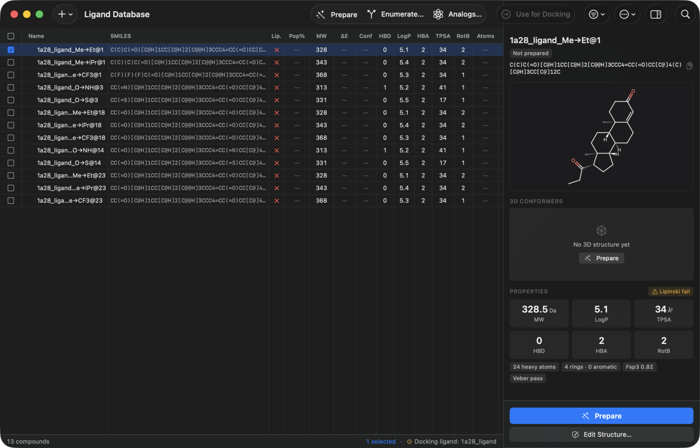

# Ligands

How compounds get into Druse and become dockable: import, chemical-form enumeration at a target pH, 3D conformer generation, and the Ligand Database with its properties and ADMET predictions.

## Importing

Every compound lives in the **Ligand Database**, a flat list of entries. An entry holds a SMILES string, optional 3D atoms and bonds, conformers, descriptors, experimental affinity and any extra columns the import carried along.

| Source | Command | Notes |
| --- | --- | --- |
| SMILES string | `ligand smiles "<smiles>"` | prepared and made the docking ligand by default |
| `.smi` | `ligand load file.smi` | one molecule per line, optional name after a tab or space (either order — the importer detects which field is the SMILES); `#` lines are skipped and unnamed molecules become `Mol_n` |
| `.csv`, `.tsv` | `ligand load file.csv` | column mapping, see below |
| `.sdf`, `.mol` | `ligand load file.sdf` | V2000 and V3000; without `prep=on` the file's 3D coordinates are kept as-is |
| `.mol2` | `ligand load file.mol2` | Tripos MOL2, multi-molecule files supported |
| `.json` | `ligand load db.json` | a previously saved Druse ligand database |
| Co-crystallised ligand | automatic on `load` / `fetch` of a PDB entry | the first HET group becomes the active ligand and an entry carrying its source chain |

```druse
ligand smiles "CC(=O)Oc1ccccc1C(=O)O" name=aspirin
ligand smiles "Cn1cnc2c1c(=O)n(C)c(=O)n2C" name=caffeine prep=off
ligand load actives.csv smiles-col=canonical_smiles name-col=chembl_id pki-col=pchembl
ligand db import library.sdf                 # same as 'ligand load' with prep=on
ligand list
ligand show 3
```

**CSV / TSV mapping.** Columns are named by header or by 1-based number: `smiles-col=`, `name-col=`, `ki-col=` (nM), `pki-col=` (−log₁₀ Ki in M), `ic50-col=` (nM). `delimiter=` is `auto` (tab when the first line has one, else comma), `comma`, `tab` or `semicolon`; `header=auto|on|off`. With `extra-cols=on` (the default) every unmapped column is kept as an entry property and becomes an extra, sortable-by-name column in the database table. When a SMILES column is not named, the importer detects which column looks like SMILES.

**Experimental 3D as a template.** When an entry already has real 3D coordinates — a co-crystallised ligand, or unprepared 3D input from SDF/MOL2 — preparation keeps them: the prepared molecule is placed onto the experimental heavy-atom coordinates, with hydrogens re-placed and relaxed. If the heavy-atom graph no longer matches (a tautomer, say), the SMILES embedding is used instead. Purely 2D input (all z equal) is not treated as a template.

**Affinity.** Ki, pKi and IC50 can be set per entry and are copied to that entry's enumerated forms. The effective pKi prefers pKi, then Ki, then IC50.

```druse
ligand affinity imatinib ki=12.5
ligand affinity 7 pki=8.2
```

**Saving.** The database round-trips to `~/Library/Application Support/Druse/ligand_database.json`.

```druse
ligand db save
ligand db load
ligand db stats
```

## Preparation pipelines

Three modes, all sharing one set of session defaults (the Enumerate sheet in the window and `ligand prep set` in the console write the same values):

| Mode | What it does |
| --- | --- |
| `enumerate` | Full protomer × tautomer × conformer ensemble at the target pH. Every kept form is inserted as its own entry below the unchanged source entry. |
| `dominant` | The same pipeline limited to one protomer and one tautomer: the entry is updated in place with its most populated form and that form's conformers. |
| `basic` | Plain RDKit preparation without pH handling: hydrogens, MMFF94 minimisation and Gasteiger charges (each switchable), one conformer. |

| Option | Default | Range | Meaning |
| --- | --- | --- | --- |
| `ph=` | 7.4 | 0–14 | target pH for protonation states and form populations |
| `pka=` | `gnn` | `gnn`, `rules` | pKa source: the Metal GNN (MAE ~1.0) or the built-in SMARTS table (~230 groups) |
| `pka-threshold=` | 2 | 0–10 | sites with \|pKa − pH\| below this get both protonation states |
| `max-protomers=` | 8 | 1–64 | protonation states of the parent kept |
| `max-tautomers=` | 10 | 1–100 | tautomers per protomer |
| `energy-window=` | 10 | 0–100 | discard forms more than this many kcal/mol (MMFF94) above the best one |
| `conformers=` | 10 | 1–500 | 3D conformers per chemical form |
| `min-population=` | 1 | 0–100 | drop enumerated forms below this population in %; the dominant form is always kept, and 0 enumerates every site |
| `temperature=` | 298.15 | 100–1000 | Boltzmann temperature in K for the conformer populations |
| `hydrogens=`, `minimize=`, `charges=` | on | — | `basic` only; the ensemble modes always add hydrogens, minimise and charge |

```druse
ligand prep all ph=7.4 max-tautomers=4 conformers=3
ligand prep unprepared mode=dominant pka=rules
ligand prep set mode=enumerate ph=7.4 conformers=10
ligand prep config
ligand prep reset
ligand prep stop
```

Entries are prepared concurrently, bounded by the app's maximum-concurrency setting ([Settings.md](Settings.md)). Starting a run cancels the one in progress; compounds already finished keep their results.

## Chemical-form enumeration

### Ionizable sites

Sites come either from the **pKa GNN** — a Metal compute model, roughly 0.1 ms per molecule, reporting a per-site pKa, whether the site is an acid or a base, and an ionizable probability — or from the **SMARTS table** of ionizable groups with literature pKa values. `ligand pka` shows either or both side by side with the ionized fraction at a pH.

Nearby basic sites get an electrostatic pKa depression before anything else happens: 3.0 units for two basic sites in the same ring, 2.0 at a topological distance ≤ 3, 1.0 at ≤ 5 and 0.3 beyond, applied to the weaker of the pair and skipped past a topological distance of 6. These values are calibrated against the Caron & Bhatt 2022 polyamine data.

```druse
ligand pka imatinib
ligand pka 4 method=both ph=7.4
```

### Protomers

The molecule is first "washed" to its unambiguous state at the pH: acids with pH − pKa above the threshold are deprotonated, bases with pH − pKa below the negative threshold are protonated. The remaining **ambiguous** sites (\|pH − pKa\| ≤ the threshold, capped at 16 sites) define the enumeration. Setting `min-population=0` lifts the threshold entirely, so every detected site is treated as ambiguous and `max-protomers` alone limits the result. In `dominant` mode a single protomer and tautomer are generated, so the threshold applies as given.

Those ambiguous sites define 2^N protonation combinations. Each combination's Henderson–Hasselbalch population is the product of its per-site fractions, with the protonated fraction 1/(1 + 10^(pH − pKa)). Combinations are ranked by population and the top `max-protomers` distinct SMILES are kept and labelled by the toggles they apply (`prot_<group>`, `deprot_<group>`, or `Parent`).

### Tautomers

Each protomer is enumerated with RDKit's `MolStandardize` `TautomerEnumerator` (asked for twice as many candidates as needed so filtering still leaves enough) and each tautomer is scored with RDKit's tautomer scoring function. Scores become relative populations through exp((score − maxScore) · ln 10), i.e. one score point is worth roughly a factor of ten in population. A form's population is its protomer's Henderson–Hasselbalch population times its tautomer weight, and the total number of forms is capped at `max-protomers × max-tautomers`.

Each form is tagged **Parent**, **Tautomer**, **Protomer** or **Taut+Prot** and shown with that label in the database.

### 3D conformers

Per form, in parallel across forms:

1. Explicit hydrogens are added.
2. `conformers=` conformers are embedded with RDKit ETKDGv3, random seed 42, RMS pruning threshold 0.25 Å. If multi-conformer embedding fails, a single embedding is attempted, then a fallback embedder.
3. All conformers are minimised with **MMFF94** (`MMFFOptimizeMoleculeConfs`, up to 1000 iterations). A form without MMFF parameters keeps its ETKDG geometry with an undefined energy rather than being dropped.
4. Gasteiger partial charges are computed.
5. Collapsed geometries are rejected; if every conformer collapses, one is re-embedded.
6. Conformers are sorted by energy ascending.

### Populations and filtering

The `energy-window` filter is applied per form: conformers more than that many kcal/mol above their own form's best are discarded. Conformer populations are then Boltzmann weights within the form, with k_BT = 0.001987204 × T kcal/mol (0.593 kcal/mol at the default 298.15 K); a form with no finite MMFF energy gets uniform weights within itself. Each conformer's final population is its within-form fraction times its form's Henderson–Hasselbalch population, normalised over everything that survived.

Finally, `min-population` drops forms below the cutoff (the dominant form is always kept) and renormalises the populations of what remains. Form entries are named `<parent>_<label>` and carry the population, the relative energy against the best form, the form kind, the conformers and a copy of the parent's affinity data.

```druse
ligand forms imatinib                   # kind, population at pH, ΔE, charge, conformers
ligand conformers imatinib              # MMFF94 energies
ligand conformers imatinib generate count=25 minimize=on
ligand use imatinib                     # most populated form, lowest-energy conformer
ligand use imatinib form=Taut1 conformer=3
```

A source molecule handed to docking uses its most populated form unless `form=` names another. `ligand list forms` lists the enumerated forms with their populations; `ligand list dockable` lists exactly what `dock batch` would dock.

## The Ligand Database window



**Table columns.** Name and SMILES (always visible), then Pop% (Boltzmann population at the target pH, colour-coded), ΔE (kcal/mol above the lowest-energy form), Conf (conformer count), MW, LogP, HBD, HBA, TPSA, RotB, Lip. (Lipinski pass/fail) and Atoms — plus one column per imported property key. Columns can be hidden (except Name and SMILES), reordered by dragging the header, and sorted by clicking it; order and visibility persist. Enumerated forms are indented under their source molecule.

**Filters.** A search field matching name or SMILES, *Lipinski-compliant only*, and a prepared-only filter. The footer shows how many of the total compounds are visible, how many are prepared, how many are enumerated forms and the total conformer count, plus the selection size.

**Toolbar.** *Add* (SMILES, a drawing or a file), *Prepare* (the dominant-form pipeline: add H → protonate at pH → minimise → charges → conformers), *Enumerate…* (the configuration sheet below), *Analogs…* (scaffold decoration and whole-molecule transforms, see [LeadOptimization.md](LeadOptimization.md)), *Use for Docking* / *Dock N*, and save / load / clear for the database file.

**Enumerate sheet.** Target pH (1–14), pKa method, pKa threshold (0.5–5.0), max tautomers (1–50), max protomers (1–20), energy cutoff (5–50 kcal/mol), conformers per form (1–100), minimum population (0–20 %), with live progress and a stop button. The sheet also states the pipeline in order: add polar H → MMFF94 minimise → Gasteiger charges → enumerate tautomers and protomers at the target pH → generate conformers → filter by Boltzmann population.

**Inspector.** For one selected entry: name with `Prepared` / `Not prepared` / `Failed` and form badges, the 2D depiction (RDKit `MolDraw2DSVG`, with proper wedge/dash stereo bonds and aromatic notation, rendered on a dedicated background thread), an embedded 3D view of the molecule, the descriptor table, affinity, imported properties and the preparation error if one occurred. For a multi-selection it switches to a batch panel. *Use for Docking* makes the entry the active docking ligand.

## Properties

**RDKit descriptors**, computed per entry (and per enumerated form, from that form's SMILES): molecular weight, exact mass, Crippen logP, TPSA, HBD, HBA, rotatable bonds, ring count, aromatic ring count, heavy-atom count, fraction of sp³ carbons, Lipinski pass/fail, Veber pass/fail.

Drug-likeness descriptors are defined on the neutral parent, so `dominant` mode keeps the parent's descriptors rather than recomputing them on an ionized form (which would shift logP by several units and inflate HBD).

```druse
ligand descriptors all
ligand descriptors 1-20
```

**ADMET predictions** come from eight small CoreML models (`ADMET_LogP`, `ADMET_LogD`, `ADMET_Solubility`, `ADMET_CYP2D6`, `ADMET_CYP3A4`, `ADMET_hERG`, `ADMET_BBB`, `ADMET_MetabolicStability`), each taking a 2048-bit Morgan fingerprint of radius 2. Reported values: logP, logD at pH 7.4, log S (aqueous solubility), CYP2D6 and CYP3A4 inhibition probabilities, hERG liability probability, blood-brain-barrier permeability probability and metabolic-stability probability. Predictions are only available when the models are bundled; Lipinski, Veber and the composite drug-likeness score are always computed from RDKit descriptors.

The drug-likeness score is a 0–1 sum of rule checks: MW ≤ 500 (0.20), −1 ≤ logP ≤ 5 (0.20), HBD ≤ 5 (0.15), HBA ≤ 10 (0.15), rotatable bonds ≤ 10 (0.15), 20 ≤ TPSA ≤ 140 (0.15).

```druse
ligand admet all
ligand admet imatinib
```

## Export

```druse
ligand db export ~/Druse/ligands.sdf                       # 3D, lowest-energy conformer
ligand db export ~/Druse/ligands.sdf conformers=all        # one record per conformer
ligand db export ~/Druse/ligands.csv subset=dockable       # all data as CSV
ligand db export ~/Druse/ligands.smi
ligand db export ~/Druse/ligands.json                      # Druse database
```

`subset=` is `all`, `prepared`, `dockable` (what `dock batch` docks) or `forms`.

## Console reference

```druse
ligand smiles <smiles> [name=] [prep=] [use=] [<prep options>]
ligand load <file> [format=] [smiles-col=] [name-col=] [ki-col=] [pki-col=] [ic50-col=]
                   [delimiter=] [header=] [extra-cols=] [prep=] [<prep options>]
ligand rename <ligand> <new-name>
ligand remove <ligands…>
ligand clear [all|forms|unprepared|failed]
ligand affinity <ligand> [ki=] [pki=] [ic50=] [clear=]
ligand list [all|prepared|unprepared|forms|dockable|failed]
ligand show <ligand>
ligand use <ligand> [form=] [conformer=]
ligand forms <ligand>
ligand conformers <ligand> [list|generate] [count=] [minimize=]
ligand prep <ligands…> [<prep options>]
ligand prep config | set [<prep options>] | reset | stop
ligand descriptors <ligands…>
ligand admet <ligands…>
ligand pka <ligand> [method=gnn|rules|both] [ph=]
ligand db import <file> [...] | export <file> [format=] [subset=] [conformers=]
ligand db stats | save | load
```

Entry selectors accept names, `#numbers`, ranges like `2-5`, and the keywords `all`, `unprepared`, `prepared` and `failed`. Run `help ligand` for the full option list with current defaults.

## See also

- [Preparation.md](Preparation.md) — the receptor side
- [BindingSite.md](BindingSite.md) — defining the pocket, including from a co-crystallised ligand
- [Docking.md](Docking.md) — docking one ligand or the whole database
- [VirtualScreening.md](VirtualScreening.md) — screening a library without importing it
- [LeadOptimization.md](LeadOptimization.md) — analog generation from a database entry
- [Console.md](Console.md) and [DruseScript.md](DruseScript.md) — scripting imports and preparation
