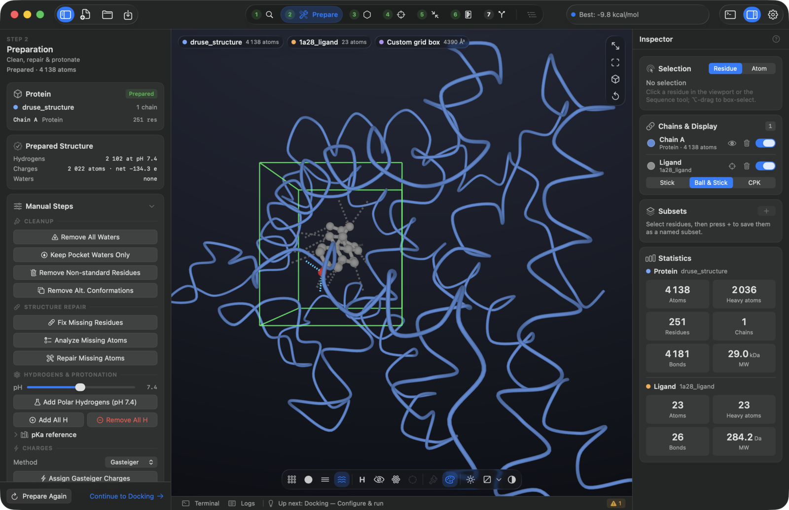

# Protein Preparation

How Druse turns a crystal structure into a docking-ready receptor: parsing, cleanup, structure repair, side-chain packing, protonation, partial charges and restrained minimisation.

## Loading a structure

| Input | Parser | Notes |
| --- | --- | --- |
| `.pdb`, `.ent` | native PDB parser | ATOM/HETATM, altLoc, occupancy, B-factor, insertion codes, CONECT bonds for HET groups, HELIX/SHEET records validated against the residues actually present |
| `.cif`, `.mmcif` | mmCIF parser backed by [gemmi](https://gemmi.readthedocs.io/) | gemmi also supplies the per-chain entity sequences (SEQRES) that the loop builder needs for residue identities, read from the original file text of either format |
| `.sdf`, `.mol` | SDF parser | multi-record files split on `$$$$`; V2000 and V3000 are both read (the counts line decides), `M  CHG` formal charges and the data items after `M  END` are kept as properties |
| `.mol2` | Tripos MOL2 parser | multi-molecule files split on `@<TRIPOS>MOLECULE`; `ATOM`, `BOND`, `SUBSTRUCTURE` sections |
| `.smi`, `.csv`, `.tsv` | RDKit through the C++ core | imported into the Ligand Database, not as a receptor — see [Ligands.md](Ligands.md) |

PDB and mmCIF files replace the protein; SDF, MOL and MOL2 files set the docking ligand. A PDB entry's first HET group becomes the active ligand and is added to the Ligand Database with its source chain, so a co-crystallised ligand is immediately available for pocket definition and redocking.

```druse
load 1hsg.pdb
load complex.cif chains=A waters=remove
fetch 1HSG                      # RCSB download, cached locally
fetch 4HHB chains=A,B waters=remove
protein                         # summary of what was loaded
```

`chains=` keeps only the listed protein chains; `waters=remove` deletes crystallographic waters at load time.

## The pipeline

"Prepare for Docking" in the Preparation step (and `prep` in the console) runs these stages in order:

1. **Short missing loops** are modelled first, before chain breaks are capped — once a gap is capped the builder can no longer bridge its anchors.
2. **Cleanup**: preferred alternate locations, non-standard residues, waters, ACE/NME caps on the chain breaks that remain.
3. **Heavy-atom reconstruction** from residue templates.
4. **FASPR repacking** of the side chains that were rebuilt in step 3.
5. **Restrained GPU minimisation** of the whole structure.
6. **Protonation states** predicted at the target pH.
7. **Template hydrogens** (all, or polar only).
8. **H-bond network optimisation**: rotors, Asn/Gln flips, His tautomers and flips.
9. **Partial charges** with the configured charge model, plus the formal-charge fallback.

Every stage is also a subcommand, so a script can prepare a receptor one step at a time.

```druse
prep                                    # the whole pipeline with the GUI defaults
prep ph=6.5 charges=eem
prep waters=pocket radius=4 hydrogens=polar
prep loops=off caps=off charges=none
prep report                             # what each stage did, step by step
```

## Cleanup

**Alternate locations.** Each residue's alternate conformations are scored by mean occupancy, then by mean B-factor (lower wins), then alphabetically by altLoc identifier. Atoms of the winning altLoc plus all atoms with a blank altLoc are kept and the altLoc field is cleared. Insertion codes are part of the residue identity, so 52 and 52A are treated as separate residues.

**Non-standard residues.** Removing them deletes ligands, cofactors and modified residues. The 20 standard amino acids, waters, existing `ACE`/`NME` caps and structural metal ions (`ZN`, `MG`, `CA`, `FE`, `MN`, `CO`, `NI`, `CU` and their charged variants) are always kept.

**Waters.** `HOH`, `WAT`, `DOD` and `H2O` residues. Three policies: keep all (the default), remove all, or keep only waters with at least one atom within a retention radius of the selected pocket centre (default 5 Å). Retained pocket waters are marked and act as rigid receptor atoms during docking, which needs a pocket from [BindingSite.md](BindingSite.md) first.

**Chain breaks and caps.** A break is reported when consecutive residue numbers in a chain are non-contiguous, or when the peptide C–N distance exceeds 1.8 Å. Uncapped break termini get an `NME` cap after the preceding residue (N at 1.33 Å from the backbone C, then CH3 at 1.46 Å) and an `ACE` cap before the following residue (carbonyl C at 1.33 Å from the backbone N, O at 1.24 Å and CH3 at 1.51 Å, placed in the amide plane at ±120°). Cap directions are built from the vacant valence of the anchor atom, falling back to the direction of the residue across the gap.

```druse
prep clean waters=remove caps=on
prep altlocs
prep nonstandard
prep waters pocket radius=4
prep caps
```

## Structure repair

`prep missing` reports numbering gaps, chain breaks and residues with missing or extra atoms against the bundled templates. The same information drives the **Issues** card in the UI.

**Missing residues (loops).** The loop builder closes gaps of at most 15 residues. Backbone geometry is ideal peptide geometry — C–N 1.335 Å, N–CA 1.458 Å, CA–C 1.525 Å, C=O 1.231 Å, N-CA-C 111.2°, CA-C-N 116.2°, C-N-CA 121.7°, CA-C=O 120.8°, CA–CA spacing ~3.8 Å per residue. Residue identities come from the original file's entity sequences (SEQRES), read through gemmi, when the raw file text is still available; otherwise the loop is built as polyalanine. Only the freshly placed loop atoms are then relaxed: `refine=gpu` (the default) runs a restrained Metal minimisation with backbone angle and omega-torsion terms (up to 500 iterations, gradient tolerance 0.05), `refine=openmm` runs an OpenMM minimisation with backbone angle and trans-peptide restraints and needs a build with OpenMM, `refine=none` keeps the raw builder geometry. Gaps longer than the limit are left as chain breaks and capped.

**Missing heavy atoms.** Each residue is matched against its reference template (Chemical Component Dictionary geometry). The template is rigidly overlaid on the atoms that are present, and any missing non-hydrogen template atom is placed at its transformed ideal position. Atoms bonded to something outside the residue are excluded from the template expectation, so covalently modified residues are not "repaired" into standard ones. Residues that receive a new side-chain atom are recorded for repacking.

```druse
prep missing
prep missing all=on
prep repair                             # loops + atoms + re-protonation
prep repair atoms
prep repair loops max-gap=12 refine=openmm
```

## Side-chain packing (FASPR)

Packing is a translation of FASPR (Huang 2020, MIT licence) onto the Dunbrack 2010 backbone-dependent rotamer library.

- **Rotamer library**: `dun2010bbdep.bin`, the Shapovalov & Dunbrack library (Structure 2011, 19(6):844–858), indexed by backbone phi/psi in 10° bins (36 × 36 per residue type) for the 18 rotameric amino acids. Rotamers are returned sorted by probability and trimmed at P < 0.01 or cumulative probability > 0.97.
- **Energy model**: CHARMM19 van der Waals with FASPR's H-bond / S–S equilibrium-distance override, side-chain–backbone and side-chain–side-chain H-bond and disulfide terms, and a rotamer-preference term from the Dunbrack probability. Self-energy pruning runs before the preference and fixed-side-chain terms.
- **Search**: Dead-End Elimination, then an exact tree-decomposition search for the global minimum energy conformation.
- **GPU**: van der Waals self- and pair-energies for atom pairs that cannot trigger the polar distance override are evaluated with Metal compute kernels; override-capable pairs and all polar terms stay on the CPU.

During the one-click pipeline FASPR repacks **only the residues whose side chain was rebuilt from a template**. Crystallographic side-chain conformations, including those lining the binding site, are left untouched. Wider scopes are explicit:

```druse
prep pack                               # residues=incomplete (the default)
prep pack residues=all
prep pack residues=selection
```

FASPR works on a heavy-atom model, so remove hydrogens before repacking everything and add them back afterwards:

```druse
prep hydrogens remove; prep pack residues=all; prep hydrogens add
```

## Protonation at a target pH

Protonation states are predicted with an empirical PROPKA-style model. Each titratable site starts from a model pKa:

| Site | Model pKa | Kind |
| --- | --- | --- |
| Asp (OD1/OD2) | 3.80 | acid |
| Glu (OE1/OE2) | 4.50 | acid |
| Cys (SG) | 9.00 | acid |
| Tyr (OH) | 10.00 | acid |
| His (ND1/NE2) | 6.50 | histidine |
| Lys (NZ) | 10.50 | base |
| Arg (NE/NH1/NH2) | 12.50 | base |
| N-terminus | 8.00 | base |
| C-terminus | 3.20 | acid |

The shifted pKa is the model value plus three contributions, each reported per residue: a **desolvation/burial** term (prefactor −13.0, surface scaling 0.25, 20 Å cutoff, buried-atom counting between 280 and 560 neighbours), a **hydrogen-bond** term with the PROPKA group exceptions (COO–His, OCO–His and Cys–His 1.60, Cys–Cys 3.60) and angular weighting, and a **charge/Coulomb** term with the two-regime dielectric treatment (4 Å and 10 Å cutoffs, dielectrics 160 and 30, minimum interaction distance 2.75 Å). Cysteines in a disulfide carry no titratable proton and are skipped. The state is then chosen by comparing the shifted pKa with the target pH; histidine can come out as HID, HIE or the doubly protonated cation.

Hydrogens are placed from residue templates, using PROPKA's proton bond lengths (N–H 1.01 Å, O–H 0.96 Å, S–H 1.35 Å) for the polar positions.

The pH slider in the UI covers 1.0–14.0 and persists; the console option is `ph=` (0–14, 7.4 at start).

```druse
prep protonate ph=7.0
prep states                             # every titratable residue
prep states type=his
prep states type=shifted                # pKa shifted by more than 1 unit
prep hydrogens add ph=7.4               # polar + non-polar
prep hydrogens remove
residue A:HIS57                         # one residue's atoms and protonation
```

`hydrogens=all` (default), `hydrogens=polar` (united-atom style receptor) and `hydrogens=none` (heavy-atom receptor, no protonation at all) select the hydrogen model for the whole pipeline.

## H-bond network optimisation

Phase 4 follows Word et al., *J Mol Biol* 1999 (Reduce). It enumerates every moveable hydrogen group, builds a conflict graph of the groups whose states interact, partitions it into independent cliques and singletons, and picks the best combination per clique.

Moveable groups:

- **Rotatable OH** — Ser OG–HG, Thr OG1–HG1, Tyr OH–HH
- **Rotatable SH** — Cys SG–HG
- **Rotatable NH3** — Lys NZ hydrogens (3-fold symmetric)
- **Amide flips** — Asn OD1↔ND2, Gln OE1↔NE2
- **Histidine** — reachable tautomers × 2 ring-flip orientations

All candidate states of all groups are scored in one batched Metal dispatch (`scoreHBondCandidates`), with a CPU path when no GPU is available. Accepted amide flips, chosen rotor angles and switched neutral-His tautomers (HID ↔ HIE) are written back into the protonation predictions, and the counts appear in the preparation report.

```druse
prep hbonds
```

## Partial charges

| Method | Implementation |
| --- | --- |
| `gasteiger` | RDKit Gasteiger charges computed on the raw PDB text and merged onto the prepared atoms by chain/residue/atom identity. Skipped above 6000 atoms, where the fallback applies. |
| `eem` | Electronegativity Equalization Method, Bultinck et al., *J. Phys. Chem. A* 2002, 106, 7887. Per-atom-type χ/η (STO-3G set, carbon/nitrogen/oxygen/sulfur resolved by hybridisation), Coulomb scaling κ = 0.529177. An (N+1)×(N+1) system is assembled — on the GPU above 256 atoms — and solved with LAPACK `sgesv` under a total-charge constraint. |
| `qeq` | Charge Equilibration, Rappé & Goddard, *J. Phys. Chem.* 1991, 95, 3358. Per-element Rappé–Goddard χ/J; off-diagonal terms use the Klopman–Ohno shielded kernel J_ij = k / sqrt(r_ij² + a_ij²) with a_ij = k(1/J_i + 1/J_j)/2 and k = 14.3996 eV·Å, so J_ij tends to the harmonic mean of J_i and J_j at short range and to k/r at long range. Same GPU-assembly / LAPACK-solve split as EEM. |
| `xtb` | GFN2-xTB Mulliken charges through the C bridge (up to 50 SCC iterations). Needs a build with xTB. |

After the chosen model runs, non-finite charges are zeroed (one inf or NaN poisons every electrostatic sum downstream), and any atom still at |q| ≤ 0.0001 falls back to its formal charge. The charge method persists for the session and is shared with docking.

```druse
prep charges method=qeq
prep charges method=eem
prep charges=none                       # as a pipeline option: skip charges entirely
```

## Restrained minimisation

`prep minimize` runs L-BFGS with GPU energy and gradient evaluation. The same minimisation runs inside the pipeline, after packing and before hydrogens are added.

- **Optimiser**: limited-memory BFGS, history size 8, bracketing line search on the weak Wolfe conditions (Armijo parameter 1e-4, curvature parameter 0.9, at most 20 line-search steps), convergence on the RMS gradient. `steps=` caps the iterations (default 100).
- **Energy**: pairwise Lennard-Jones plus positional restraints on the GPU (`prep_vdw_restraint`), harmonic bond terms on the CPU with k = 300 kcal·mol⁻¹·Å⁻². LJ σ per atom is 2·R_vdW·2^(−1/6), so the minimum of any pair sits at the Bondi contact distance R_i + R_j. Bonded pairs are excluded (1-2 and 1-3 skipped, 1-4 scaled) via a host-built exclusion list; steric cutoff 8 Å.
- **Region restraints**: backbone N/CA/C/O are strongly restrained (500 kcal·mol⁻¹·Å⁻²), existing side chains moderately (50), reconstructed atoms and hydrogens are free (0).

```druse
prep minimize
prep minimize steps=200
```

OpenMM, when the build has it, is used for loop relaxation (`prep repair loops refine=openmm`). GFN2-xTB appears in preparation as a charge model; its geometry optimisation with D4 dispersion and ALPB implicit solvation is a post-docking step — see [Docking.md](Docking.md).

## In the Preparation step



- **Protein** — chains with residue counts and type, water count, HETATM group tags, and a `Raw` / `Prepared` badge.
- **Prepared Structure** — read back from the prepared molecule itself, so it stays true after later manual edits: hydrogen count and the pH they were placed at, number of charged atoms and the net charge in e, how many chain breaks were capped with ACE/NME, and how many waters remain.
- **Issues** — missing residues as chain and gap range, chain breaks as `prev→next (capped/uncapped)`, and incomplete residues with the atoms they are missing (first six, then a count). Shown only when the structure has issues.
- **Manual Steps** — four groups mirroring the console subcommands: *Cleanup* (remove all waters, keep pocket waters only, remove non-standard residues, remove alternate conformations), *Structure Repair* (fix missing residues, analyse missing atoms, repair missing atoms), *Hydrogens & Protonation* (pH slider, add polar hydrogens, add/remove all hydrogens, re-optimise the H-bond network, pack side chains), *Charges* (the four charge models). The section's expanded state is remembered across launches.
- **Footer** — the one-click *Prepare for Docking* button (it becomes *Prepare Again* once the structure is prepared, next to the link to the next step) and a one-line summary of what it will do at the current pH.

## Console reference

```druse
prep [ph=] [charges=] [waters=] [radius=] [nonstandard=] [caps=] [loops=] [hydrogens=]
prep clean [altlocs=] [nonstandard=] [waters=] [radius=] [caps=]
prep altlocs
prep nonstandard
prep waters [remove|pocket] [radius=]
prep caps
prep missing [all=]
prep repair [all|atoms|loops] [max-gap=] [refine=gpu|openmm|none]
prep pack [residues=incomplete|all|selection]
prep protonate [ph=]
prep states [type=all|charged|his|shifted]
prep hydrogens [add|remove] [ph=]
prep hbonds
prep charges [method=gasteiger|eem|qeq|xtb]
prep minimize [steps=]
prep report
```

Run `help prep` for the full option list with current defaults.

## See also

- [Ligands.md](Ligands.md) — the ligand side of preparation, including the pKa GNN
- [BindingSite.md](BindingSite.md) — pocket detection, needed for `waters=pocket`
- [Docking.md](Docking.md) — how the prepared receptor is used
- [Console.md](Console.md) and [DruseScript.md](DruseScript.md) — scripting preparation
- [Settings.md](Settings.md) — concurrency and logging
