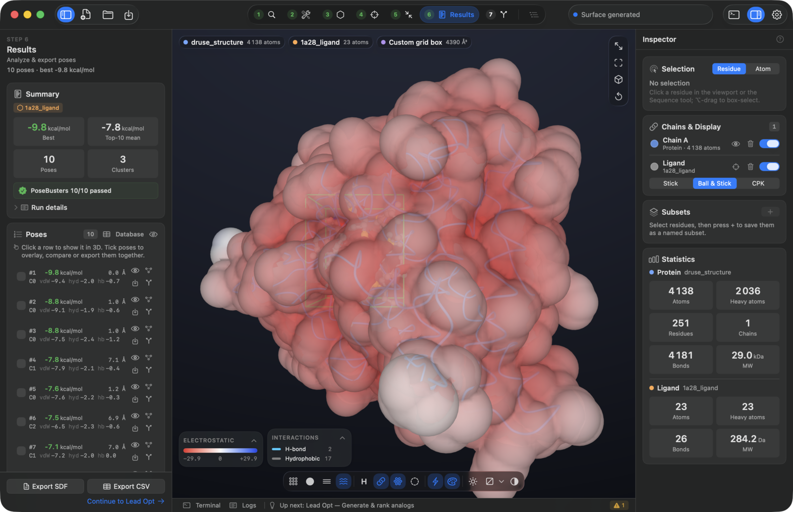

# Visualization

The 3D viewport: a Metal renderer with impostor geometry, representation and colour modes, molecular surfaces, interaction overlays, picking, camera control and offscreen snapshots.



## The renderer

`Renderer/Renderer.swift` is a single `@MainActor` Metal renderer owned by `AppViewModel.renderer`. It is created once at launch from a temporary `MTKView` (`DruseApp.initializeRenderer`) and then attached to the `CAMetalLayer` that `Renderer/MetalView.swift` manages; the app deliberately has no File ▸ New Window, because a second window would share the one renderer.

- **Triple buffering.** Three uniform buffers rotate per frame (`maxFramesInFlight = 3`), gated by a `DispatchSemaphore`, so the CPU never writes uniforms the GPU is still reading from shared memory.
- **On-demand redraw.** The view is created with `isPaused = true`, `enableSetNeedsDisplay = true` and `preferredFramesPerSecond = 60`, so nothing is drawn until state changes. Almost every renderer property (`renderMode`, `enableClipping`, `surfaceOpacity`, `chainColorMap`, …) calls `setNeedsRedraw()` in its `didSet`; mouse handlers call `draw()` directly rather than setting `needsDisplay`, so a drag frame lands in the same event cycle.
- **Formats.** BGRA8 unorm colour, 32-bit float depth, 4× MSAA.

### Impostor geometry

Atoms and bonds are not meshes. `Metal/RenderShaders.metal` draws one four-vertex triangle strip per instance and solves the surface analytically in the fragment shader:

- `atomVertex` / `atomFragment` — a screen-aligned quad per atom, with a ray-sphere intersection per fragment that writes true per-pixel depth. Spheres stay perfectly round at any zoom and cost four vertices each.
- `bondVertex` / `bondFragment` — the same trick for bond cylinders.
- `ribbonVertex` / `ribbonFragment` — real triangles, for the secondary-structure ribbon.
- `interactionLineVertex` / `interactionLineFragment`, `gridBoxVertex` / `gridBoxFragment`, `surfaceVertex` / `surfaceFragment`, `backgroundVertex` / `backgroundFragment` — overlays, box wireframe, surface mesh and background gradient.

## Representation modes

`RenderMode` (`Models/MolecularModels.swift`) has four modes. Each sets an atom radius scale and a bond radius scale:

| Mode | Console name | Atom scale | Bond scale |
|---|---|---|---|
| Ball & Stick | `ballstick` | 0.30 | 1.0 |
| Space Filling | `space` | 1.00 | 0.0 |
| Wireframe | `wire` | 0.12 | 0.8 |
| Ribbon | `ribbon` | 0.25 | 0.0 |

Space filling draws van der Waals spheres with no bonds; wireframe draws thin bonds with small dots at atom centres; ribbon replaces the protein backbone with a spline and draws no bonds, so chosen side chains come back as ball-and-stick.

The ligand can deviate from the protein's mode. `workspace.ligandRenderMode` is an override; when it is unset the ligand follows the global mode, except under ribbon, where it falls back to ball-and-stick (`effectiveLigandRenderMode`). Console: `view ligand-mode=space` or `view ligand mode=space`, with `auto` restoring the follow behaviour.

### Ribbon

`RibbonMeshGenerator` in `Renderer/MeshGenerators.swift` fits a Catmull-Rom spline through the Cα trace and extrudes a cross-section that depends on the secondary-structure assignment:

| Element | Cross-section (width × height, Å) | Colour |
|---|---|---|
| Helix | 2.0 × 0.4 | red |
| Sheet | 2.0 × 0.2, with an arrowhead at the C-terminal end of each strand | yellow |
| Coil | 0.3 × 0.3 | grey |

Under the chain-coloured scheme the chain palette colour replaces these element colours; the chain colour map is built before the ribbon mesh so the generator can use it.

### Side chains in ribbon mode

`SideChainDisplay` chooses which residues get explicit atoms on top of the ribbon: `None`, `Interacting` (residues with detected interactions in the shown pose), `Selected` (the current selection) and `All`. Backbone atoms are dropped (`N`, `CA`, `C`, `O`, `OXT`, `H`, `HA`), except Cα, which is kept as the visual attachment point to the ribbon. Non-protein chains — ligands, cofactors, waters — keep their atoms in ribbon mode instead of disappearing.

Console: `view side-chains=interacting`, or `view protein side-chains=all`. The control is disabled outside ribbon mode.

## Colour

`WorkspaceState.MoleculeColorScheme` offers three schemes:

- **Element (CPK)** — per-element colours throughout.
- **Ligand Focus** — the whole protein in one light grey (0.65), ligand carbons in gold; heteroatoms keep their CPK colours, so the ligand reads clearly inside the site.
- **Chain Colored** — a per-chain palette colour.

The chain palette has ten entries (blue, red, green, gold, purple, teal, orange, grey, pink, lime) and wraps for proteins with more than ten chains.

Each chain can then override the scheme independently. `chainColorModes[id]` is `cpk`, `chainDefault` (palette) or `custom`, with the custom RGB in `chainColorOverrides[id]`. `chainColorScopes[id]` decides whether a colour paints carbons only (the default, matching the PyMOL/ChimeraX "colour carbons by chain" convention) or every atom. The ligand has the same pair: `ligandCarbonColor` and `ligandColorCarbonsOnly`.

Console colours are a name, `#rrggbb`, or `r,g,b` (0–1, or 0–255 when any component exceeds 1). The named set is white, black, gray, lightgray, red, green, blue, cyan, magenta, yellow, gold, orange, pink, purple, teal, salmon, lime, brown.

```
view scheme=ligand-focus
view protein color=lightgray scope=all
view chain A color=chain
view chain B color=#3366cc scope=carbons
view ligand carbon-color=gold carbons-only=on
view ligand carbon-color=default
```

Lighting is either uniform (flat, the default) or directional, toggled with `view lighting=directional` or the canvas sun button.

## Molecular surfaces

`Renderer/SurfaceGenerator.swift` drives `Metal/SurfaceCompute.metal`: it samples a scalar field on a grid padded 6 Å around the bounding box, then runs marching cubes on the GPU (`marchingCubesCount` + `marchingCubesEmit`, with `marchingCubesSinglePass` as a fallback) to emit a vertex and index buffer the renderer draws directly. Generation runs off the main actor, so large proteins do not freeze the UI; `workspace.isGeneratingSurface` reports progress and the console waits on it.

Two field types exist. `computeDistanceField` produces the Connolly / solvent-excluded surface from a signed distance field, and `computeGaussianField` produces a Gaussian-blob surface. The app builds Connolly surfaces — `workspace.surfaceType` defaults to `.connolly` and there is no UI or console switch for the Gaussian field.

Four colourings, each a separate kernel:

| Mode | Console | Kernel |
|---|---|---|
| Uniform | `uniform` | — |
| Electrostatic | `esp` | `computeSurfaceESPValues` |
| Hydrophobicity | `hydrophobicity` | `computeSurfaceHydrophobicityValues` |
| Pharmacophore | `pharmacophore` | `computeSurfacePharmacophore` |

Each non-uniform mode supplies a `SurfaceLegend` (a gradient or a categorical key) that the canvas displays.

Controls and their defaults:

- **Probe radius** — 1.4 Å (water). The console accepts 0.5–5 Å; the canvas slider covers 1.0–4.0 Å with presets Water 1.4, Small molecule 1.8, Ligand access 2.2, Large pocket 3.0. A larger probe gives a smoother, more ligand-accessible surface.
- **Grid spacing** — 0.5 Å. The console accepts 0.2–2 Å; the canvas offers Fine 0.3 Å, Normal 0.5 Å, Coarse 0.7 Å. Finer is more detailed and slower.
- **Opacity** — 0.85. The console accepts 0–1; the canvas slider covers 10–100 %.

Changing the probe, the spacing or the colouring rebuilds the surface; changing the opacity does not.

```
view surface on color=esp opacity=0.6
view surface probe=2.2 spacing=0.3
view surface off
```

The surface is computed on the protein, so `view surface on` fails with no protein loaded.

## Overlays

**Interaction lines.** `updateInteractionLines` builds one line per `MolecularInteraction` of the displayed pose, from the ligand atom to the protein atom, coloured by interaction type and dashed (dash length 0.15). `view interactions on` requires a pose to be shown first (`pose show <n>`); `view interactions off` clears them.

**Pharmacophore constraint indicators.** Enabled constraints are drawn through the same pipeline from the source atom to each target position, solid for hard constraints and dashed for soft ones, coloured by the constraint's interaction type.

**Ghost ligands.** `updateGhostPose` overlays a docked pose as translucent ball-and-stick geometry while the original ligand stays in place, so a pose can be compared against the input or crystal conformer without replacing it.

**Docking grid box.** `updateGridBox` emits the twelve edges of the search box as a line wireframe around the pocket centre and half-extents. Default line width 2.5 screen pixels (console range 0.5–10) and a green default colour. `view grid on|off`, with `width=` and `color=`; it needs a selected pocket or an initialised grid, otherwise it points you at `pocket detect` or `pocket box center=x,y,z`.

**Background.** A gradient whose opacity runs 0–1. At 0 the backdrop is plain white or black (following the theme), which is what you want for figures; at 1 it is the full gradient. `view background <opacity>`.

## Z-slab clipping

Clipping keeps only a slab of the scene along the view axis, which is how you see into a buried pocket. The slab is stored in object space (`slabCenter`, `slabHalfThickness`, `slabOffset`) so it does not drift when you zoom; `clipNearZ`/`clipFarZ` remain as a view-space fallback. `focusOnPocket` anchors the slab on the pocket centre with a half-thickness of the pocket radius plus 6 Å. Turning clipping off releases the anchor, so the next slab follows the camera again.

Defaults: thickness 20 Å (range 2–40), offset 0 Å (range −20 to +20).

```
view clip on thickness=12 offset=-4
view clip off
```

## Selection and picking

Picking is a GPU object-ID pass, not a CPU ray cast. `pickAtom` renders atom IDs into an off-screen `R32Uint` texture using the same ray-sphere fragment test as the display shader, with the scissor rectangle restricted to the single clicked pixel, then reads that one pixel back. The cost is proportional to the atoms covering one pixel rather than the whole screen, and the result is pixel-exact — including for atoms that are partly occluded.

In ribbon mode there are no atom impostors for the backbone, so a miss falls through to `pickRibbonResidue`, a hit test against the stored Cα control points, which selects the residue.

`workspace.selectionMode` is `Atom` or `Residue`. Option+drag draws a box and selects every atom whose projected centre falls inside it (`atomsInRect`); holding Shift on release adds to the existing selection instead of replacing it. Escape clears the selection.

Selection and visibility also have their own console verbs:

```
select chain B; hide selection
hide chain B
show chain B
show all
select within 5 of ligand; center selection
center ligand
```

`show`, `hide` and `center` are GUI-only; `hide` is a display-only operation and does not remove atoms from the model.

## Camera

`Renderer/Camera.swift` is an arcball with a turntable constraint: horizontal drags orbit around global Y so "up" stays consistent, vertical drags orbit around the camera's own right axis, which avoids gimbal lock. Projection is right-handed with Metal's [0, 1] clip depth, 45° vertical field of view, near plane 0.1 and far plane `max(500, distance + 2 × fitted radius)` so large assemblies are not depth-clipped when zoomed out.

| Gesture | Action |
|---|---|
| Drag | Orbit |
| Shift+drag, or middle-button drag | Pan |
| Ctrl+drag | Z-roll (spin around the viewing axis) |
| Cmd+drag | Dolly zoom; dragging up zooms in |
| Option+drag | Box selection (Shift adds to the selection) |
| Scroll wheel | Zoom; horizontal or momentum scrolling pans |
| Pinch | Zoom |
| Click | Pick atom or ribbon residue; Option-click toggles |
| Double-click | Focus the picked atom |
| Right-click | Context menu |

`fitToSphere` places the camera at `radius / sin(fov/2) × 1.2`, never closer than 2 Å, and resets the orientation. `reset()` returns to the identity orientation, origin target and distance 15. Zooming clamps the distance at 0.5 Å.

The console camera verbs are GUI-only, since they need a live viewport:

```
view fit             # all, protein, ligand, pocket or selection
view fit pocket
view reset
view rotate y=90 x=-15 z=10
view zoom 2          # factor 0.05–20; 2 = twice as close
```

`view rotate` uses the same axes as the mouse: `y` turns around global Y, `x` tilts around the camera's right axis, `z` rolls around the viewing axis.

## Snapshots

`view snapshot <file>` renders the scene offscreen at an explicit size and writes an image, with the same MSAA and shading as the viewport. It is the figure-export path and the one `view` subcommand that works headless.

```
view snapshot figures/pose1.png
view snapshot figures/pose1.png width=2400 height=1600 fit=pocket theme=light
```

- Formats: `.png`, `.jpg`/`.jpeg`, `.tif`/`.tiff`, chosen from the extension.
- Size: 16 to 16384 pixels per side (Metal's 2D texture limit on Apple silicon). The default is the current drawable size, or 1600 × 1200 when there is no window.
- `fit=` frames `all`, `protein`, `ligand`, `pocket` or `selection` before rendering. Headless runs default to `all`.
- `theme=dark|light` overrides the background for this one image and is restored afterwards.
- The snapshot's aspect ratio applies to that frame only; the viewport keeps its own.

Headless, where no window and therefore no renderer exists, the command builds one with `Renderer.makeWindowless()` (BGRA8, 32-bit depth, 4× MSAA), pushes the workspace state into it, re-creates the grid box, interaction lines and — if enabled — the surface, renders, and tears the renderer down again. Every other display setting still applies, because view state lives in `WorkspaceState` rather than in the renderer: a headless script can set the representation, colours, surface and clipping, then take the picture. Camera verbs are skipped with a warning instead, and other `view` changes report that there is nothing to show but the setting will be used by `view snapshot`.

## Canvas controls

The viewport overlays live in `Views/CanvasOverlays.swift`:

- **Top-left — molecule chips.** The loaded protein (with atom count), the ligand (with atom count) and the selected pocket (with volume in ų). The protein and ligand chips can unload their molecule.
- **Top-right — camera cluster.** Fit to View (⌘0), Center on Ligand, Center on Protein, Reset Camera.
- **Bottom-centre — display toolbar.** Four groups separated by dividers, plus an opacity button:
  1. *Representation* — the four render modes (⌃⌘1–4).
  2. *Visibility* — Hydrogens (⌃⌘H, disabled when the protein has none), Side Chains (ribbon mode only, with a radio-group popover), Surface, Probe Radius (needs a visible surface; popover with the probe slider, the four presets and the grid picker).
  3. *Colour* — Surface Coloring (needs a visible surface) and Color Scheme, both radio-group popovers.
  4. *Lighting & view* — Lighting, and Clipping with a disclosure popover for thickness and offset.

  When the canvas is too narrow, group 4 and the opacity button collapse into a single "…" button that opens a combined *View Options* panel with directional lighting, Z-slab clipping, the clipping sliders, the probe controls and the opacity sliders.
- **Bottom — docking HUD**, shown directly above the display toolbar while a run is in progress. It carries no Stop button of its own; Stop lives in the toolbar activity capsule.
- **Bottom-left — legends.** The surface legend when a non-uniform surface colouring is visible, and the interaction legend during the Docking, Results and Lead Opt steps when the shown pose has interactions. They sit on their own row above the HUD so they never cover it, and use an opaque background rather than glass, which would smear the atoms behind them.

`view status` prints the whole display state as a table: mode, ligand mode, protein and ligand visibility, hydrogens, lighting, scheme, per-chain colours and hidden chains, ligand carbon colour, side chains, surface state with opacity/probe/grid, background opacity, clipping, and grid line width and colour.

## Keyboard shortcuts

Menu commands (`App/DruseApp.swift`), active anywhere in the app:

| Shortcut | Action |
|---|---|
| ⌃⌘1 … ⌃⌘4 | Ball & Stick, Space Filling, Wireframe, Ribbon |
| ⌃⌘H | Toggle hydrogens |
| ⌘0 | Fit to view |
| ⌃⌘S | Show/hide the navigator |
| ⌥⌘0 | Show/hide the inspector |
| ⌃` | Show/hide the terminal |
| ⇧⌘Y | Show/hide the logs |
| ⌘L | Ligand Database window |
| ⇧⌘R | Results Database window |
| ⌘1 … ⌘8 | Jump to a workflow step |
| ⌘] / ⌘[ | Next / previous step |
| ⌘? | Druse Help |
| ⌘O / ⇧⌘O / ⌘S | Open, Open Project, Save Project |

Keys handled by the canvas itself when it has focus (`MetalView`):

| Key | Action |
|---|---|
| Space | Fit to view |
| 1 … 4 | Render mode |
| H | Toggle hydrogens |
| L | Toggle lighting |
| Escape | Deselect all |

## See also

- [Analysis](Analysis.md) — interactions, pose comparison and the diagrams the interaction lines come from
- [BindingSite](BindingSite.md) — pockets, metrics and the grid box the overlay draws
- [Docking](Docking.md) — poses, ghost overlays and pose navigation
- [Console](Console.md) and [DruseScript](DruseScript.md) — the `view`, `show`, `hide` and `center` verbs in full, and headless snapshots
- [Architecture](Architecture.md) — where the renderer sits in the three-layer stack
