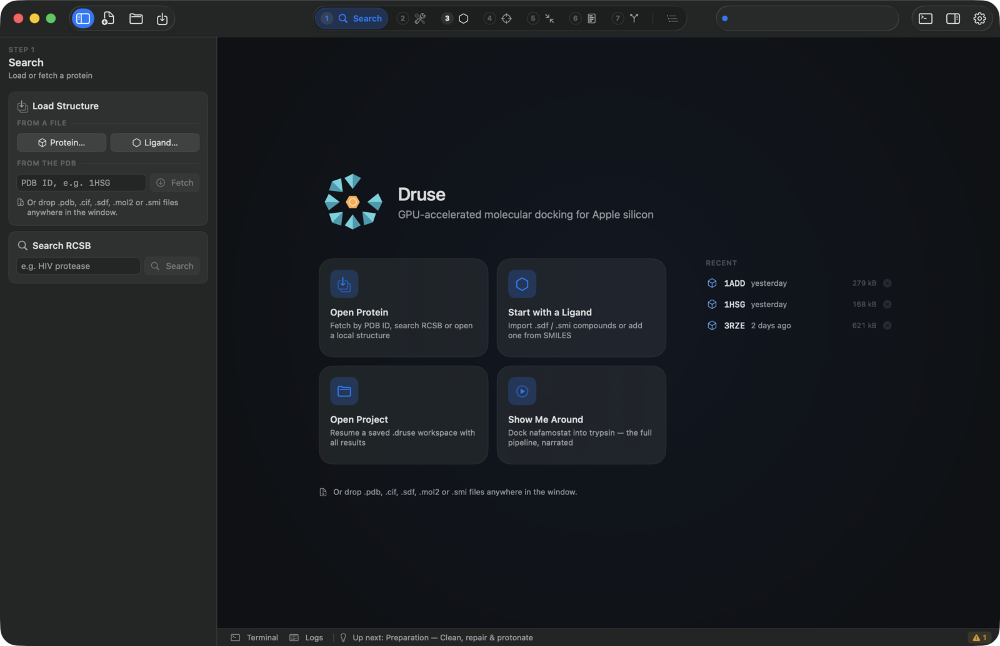
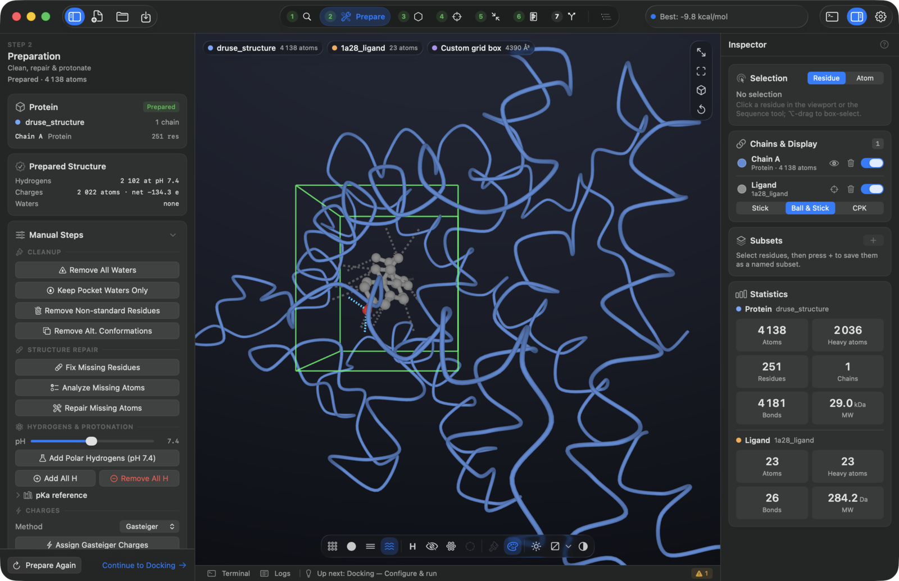
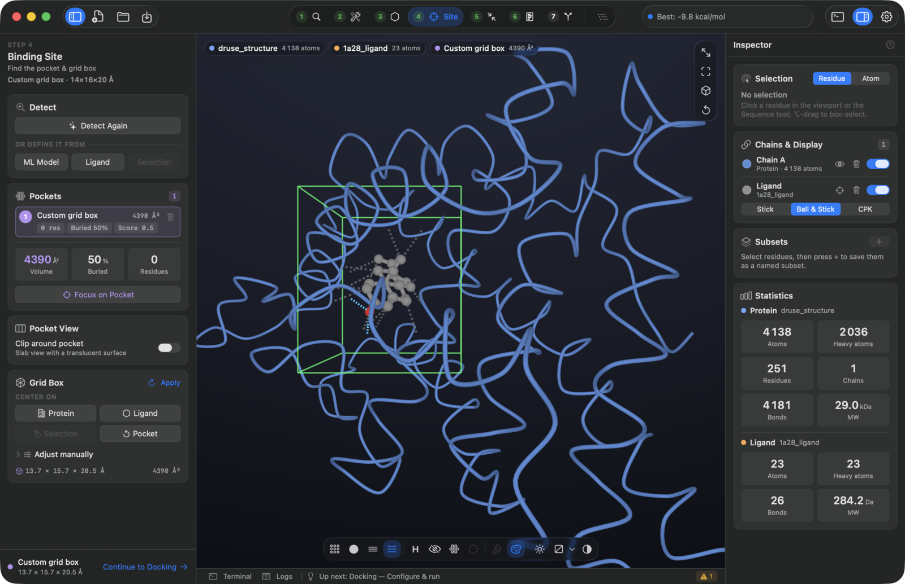
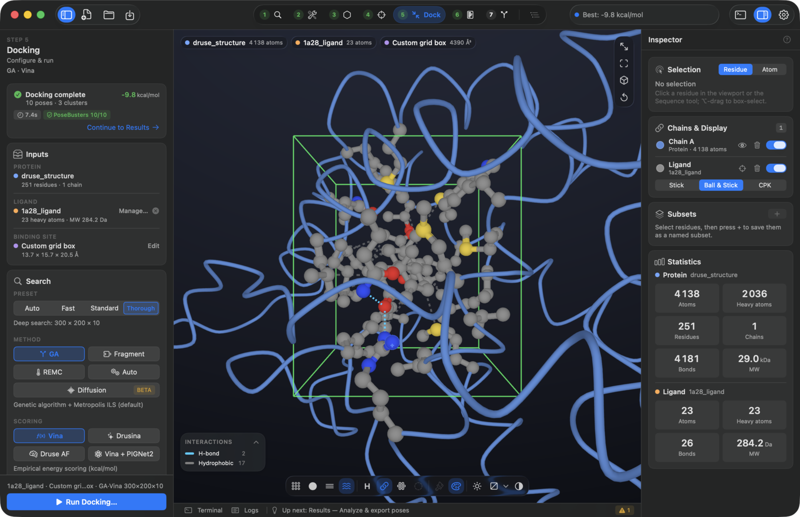
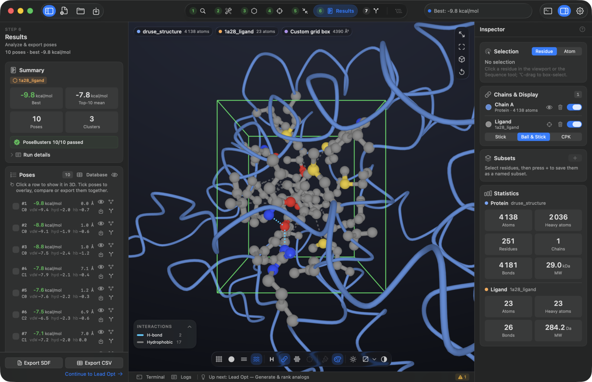
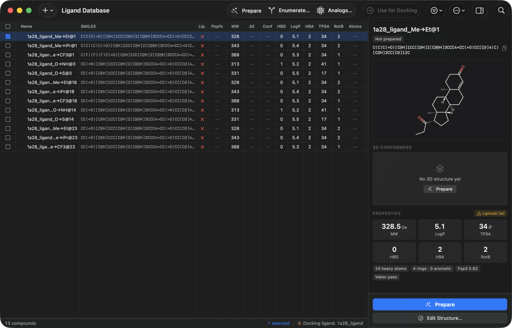
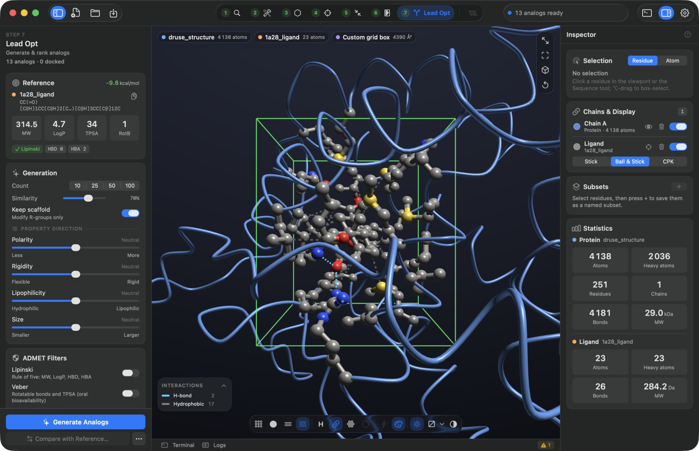
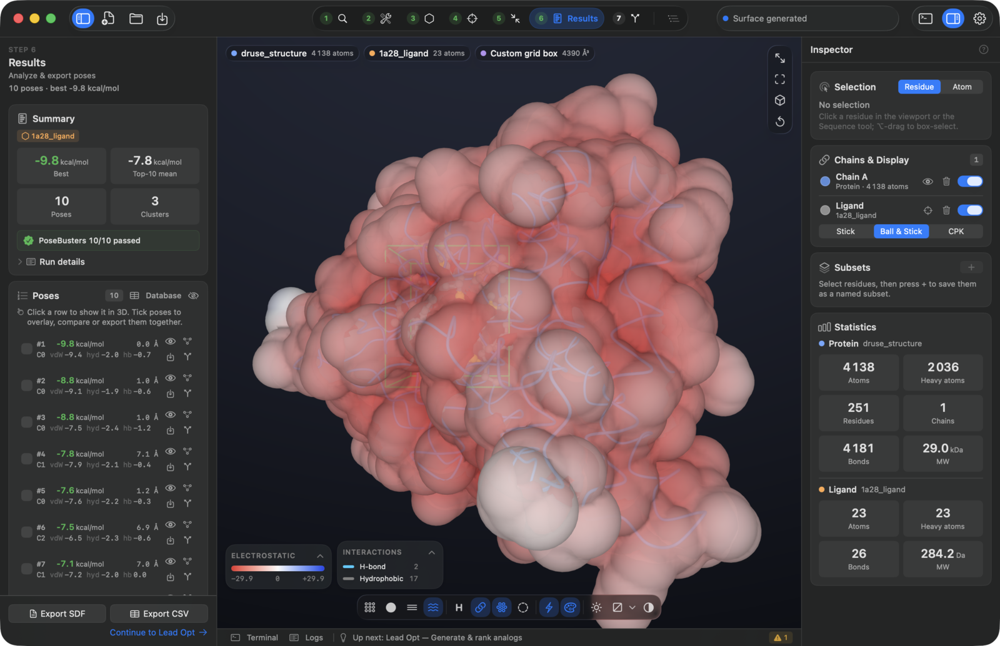
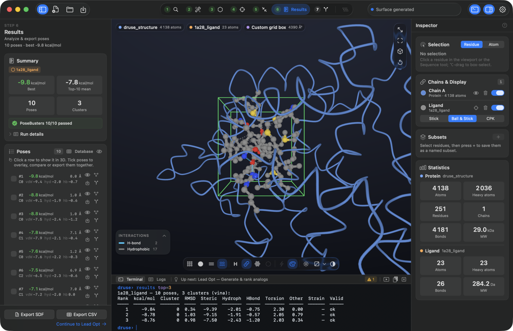

<p align="center">
  
</p>

<h1 align="center">Druse</h1>

<p align="center">
  <strong>GPU-accelerated structure-based drug design for macOS</strong>
</p>

<p align="center">
  
  
  
  
  
</p>

Druse performs receptor preparation, binding-site identification, flexible-ligand docking into a rigid or partly flexible receptor, pose rescoring, interaction analysis and analog enumeration. Search, scoring, neural-network inference and rendering are implemented as Metal compute kernels and run on the integrated GPU; the cheminformatics layer is RDKit, gemmi, OpenMM and a native GFN2-xTB implementation behind a C interface.

The application is a single bundle with no external runtime, and every operation is also available as a command, either in the built-in terminal or headless from a shell.

<p align="center">
  
</p>

---

## Installation

<p align="center">
  <a href="https://github.com/Vitruves/Druse/releases/download/0.1.1/Druse-0.1.1.dmg">
    
  </a>
</p>

macOS 26.0 or later, Apple Silicon. The build is unsigned: on first launch, Control-click `Druse.app` and choose **Open**, or run `xattr -cr /path/to/Druse.app`.

Homebrew dependencies, the C++ core build and the DMG script are in **[Docs/Installation.md](Docs/Installation.md)**.

---

## Receptor preparation



A crystal structure is read from PDB or mmCIF and reduced to a docking-ready receptor in one pass, or stage by stage. Alternate locations are resolved by occupancy then B-factor; waters are kept, removed, or retained within a radius of the site; non-standard residues and cofactors are optionally stripped, with structural metal ions preserved. Missing heavy atoms are rebuilt, gaps of up to 15 residues are modelled as loops, and chain-break termini are capped with ACE/NME. Rebuilt side chains are repacked with FASPR against the backbone-dependent Dunbrack rotamer library.

Hydrogens are added for a target pH, with residue pK<sub>a</sub> values from a PROPKA-style empirical model: a model pK<sub>a</sub> per titratable group shifted for desolvation, hydrogen bonding and Coulomb interactions. The hydrogen-bond network is then optimized over Asn/Gln amide flips and His tautomers. Partial charges are assigned by EEM (GPU), QEq with Klopman–Ohno shielding, Gasteiger, RDKit templates or GFN2-xTB Mulliken populations, and the receptor is relaxed by restrained L-BFGS on the GPU, with rebuilt loops optionally refined under OpenMM.

→ **[Docs/Preparation.md](Docs/Preparation.md)**

## Binding-site definition



Sites are detected geometrically by alpha-sphere probing, clustered with DBSCAN and ranked by a 26-direction buriedness score, optionally combined with a CoreML pocket predictor. Each candidate reports volume in ų, buriedness, a druggability score and its lining residues. The search box can equally be fitted around a co-crystallized ligand with a chosen padding, centred on a selection, or specified numerically.

→ **[Docs/BindingSite.md](Docs/BindingSite.md)**

## Docking



The default protocol propagates a population of ligand poses against precomputed grid maps, alternating stochastic perturbation under a Metropolis acceptance criterion with periodic local optimization; local optimization uses analytical gradients with SIMD-cooperative reduction rather than finite differences. Alternatives are hierarchical fragment growth with anchor placement and beam-search pruning, replica-exchange Monte Carlo, and a reverse-diffusion search guided by DruseAF attention gradients. Receptor side chains in the site can be sampled together with the ligand pose.

Search effort is set by preset or by explicit population, generation and run counts. Pharmacophore constraints — hydrogen bond, hydrophobic, aromatic, salt bridge, metal coordination — can be imposed with per-constraint weights, and search parameters can be auto-tuned from receptor size, site shape and ligand rotatable-bond count. Libraries are docked in batch with grid reuse.

→ **[Docs/Docking.md](Docs/Docking.md)** · **[Docs/VirtualScreening.md](Docs/VirtualScreening.md)**

## Scoring

| Function | Type | Quantity | Terms |
|---|---|---|---|
| **Vina** | Empirical | kcal/mol | Gaussian steric, repulsion, hydrophobic, hydrogen bond, torsion penalty |
| **Drusina** | Extended empirical | kcal/mol | Vina baseline plus electrostatics, salt bridges, π–π, π–cation, halogen bonds, metal coordination, CH–π, amide–π, chalcogen bonds, torsion strain |
| **DruseAF v4** | Pairwise geometric network over interatomic distances | pK<sub>d</sub> | Learned (~134 K parameters), native Metal inference |
| **PIGNet2** | Physics-informed graph neural network | kcal/mol | Learned with physics-based interaction constraints |

Vina and Drusina terms are reported per pose and sum to the total: the intramolecular contribution is re-referenced to the best pose, and the residual is surfaced separately. PIGNet2 is applied as a reranker over the final population and explicit cluster representatives, not as the per-generation search potential. Both neural functions score against the 256 receptor heavy atoms nearest the site centre within 10 Å.

Post-processing covers explicit-atom rescoring with basin hopping, MMFF94 torsion-strain filtering and optional GFN2-xTB refinement.

→ **[Docs/Scoring.md](Docs/Scoring.md)**

## Pose analysis



Poses are grouped by greedy leader clustering on symmetry-aware RMSD, evaluated leader-against-candidate rather than as a full matrix, with cluster representatives retained for rescoring. Each pose carries its term decomposition, a PoseBusters-style validity verdict, RMSD to a reference ligand when one is loaded, and a detected interaction set drawn in 3D and as a 2D diagram. Selected poses can be overlaid and compared by pairwise RMSD matrix and shared-interaction map. Results export to SDF, CSV or a PDB complex.

→ **[Docs/Analysis.md](Docs/Analysis.md)**

## Ligand handling



Compounds are imported from SDF, MOL2, PDB, SMILES or delimited text with column mapping, or taken from a loaded structure. Preparation enumerates protomers and tautomers at a target pH with Boltzmann-weighted populations under an energy window, then embeds and MMFF94-minimizes conformers per retained form. The database stores structures, properties and measured affinities, and is filterable on any column.

→ **[Docs/Ligands.md](Docs/Ligands.md)**

## Analog enumeration



Analogs are generated from a docked reference by curated substitution rules, restricted to R-groups when the scaffold is to be preserved and filtered by Tanimoto similarity to the parent. Generation is biased along polarity, rigidity, lipophilicity and size, gated on Lipinski and Veber criteria, then each analog is docked into the same site at reduced budget and compared to the parent by score difference, a property profile and predicted ADMET. Generated analogs enter the ligand database.

→ **[Docs/LeadOptimization.md](Docs/LeadOptimization.md)**

## Visualization



A triple-buffered Metal renderer with analytic impostor spheres and cylinders, ribbon secondary structure, Connolly surfaces coloured by electrostatic potential, hydrophobicity or pharmacophore features, interaction lines, ghost poses, Z-slab clipping and GPU object-ID picking. Redraw is on demand. Offscreen snapshots can be rendered at arbitrary resolution, including headless.

→ **[Docs/Visualization.md](Docs/Visualization.md)**

---

## Command language



Every operation above is a **DruseScript** command. The same language drives the terminal inside the window (⌃\`, with Tab completion, inline suggestion, history and reverse search) and the binary run without a window:

```bash
druse Examples/dock_one_ligand.druse
druse --eval "fetch 1hsg; prep; pocket detect; dock preset=fast; results top=5"
```

Statements are `verb [subverb] [positional…] [key=value…]`, separated by newlines or `;`, with `#` comments, `set name = value` assignments and `$name` substitution. There is no control flow: it is a console language, not a scripting language. Headless runs report through exit codes and write no window; commands that only affect the 3D view are skipped with a warning, except `view snapshot`, which renders offscreen.

The `druse` command and fish/zsh/bash completions are installed from **Settings ▸ Command Line**, or with `cli install` and `cli completions install`.

→ **[Docs/Console.md](Docs/Console.md)** · **[Docs/DruseScript.md](Docs/DruseScript.md)** · **[Examples/](Examples)**

---

## Documentation

| | |
|---|---|
| [Installation](Docs/Installation.md) | Requirements, Gatekeeper, building from source, packaging |
| [Preparation](Docs/Preparation.md) | Parsing, cleanup, repair, packing, protonation, charges, minimization |
| [Ligands](Docs/Ligands.md) | Import, form enumeration, conformers, the database |
| [Binding site](Docs/BindingSite.md) | Detection, metrics, grid box definition |
| [Docking](Docs/Docking.md) | Search algorithms, presets, constraints, batch runs |
| [Scoring](Docs/Scoring.md) | Vina, Drusina, DruseAF v4, PIGNet2, post-docking refinement |
| [Analysis](Docs/Analysis.md) | Clustering, interactions, validity, comparison, export |
| [Virtual screening](Docs/VirtualScreening.md) | Library docking, filters, ranked output |
| [Lead optimization](Docs/LeadOptimization.md) | Analog generation, property bias, mini-docking |
| [Visualization](Docs/Visualization.md) | Representations, surfaces, camera, snapshots |
| [Console](Docs/Console.md) | In-app terminal and headless mode |
| [DruseScript](Docs/DruseScript.md) | Language and complete command reference |
| [Settings](Docs/Settings.md) | Core limit, viewport, logging, command-line install |
| [Benchmark](Docs/Benchmark.md) | CASF-2016 harness and scoring-function comparison |
| [Architecture](Docs/Architecture.md) | C++ core, Metal kernels and Swift application |

---

## License

Apache License 2.0 — see [LICENSE](LICENSE). Third-party attributions and citation details are in [NOTICE](NOTICE).

<p align="center">
  <sub>Copyright © 2026 Johan H.G. Natter</sub>
</p>
